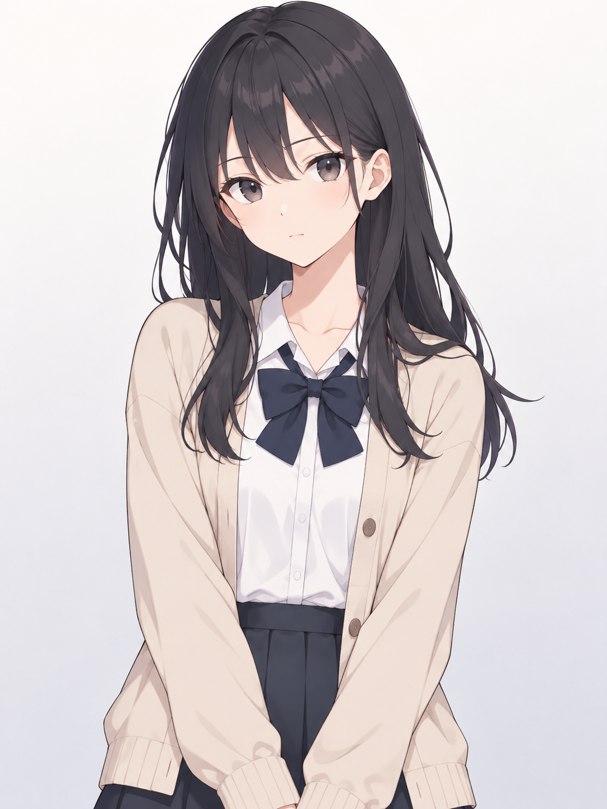
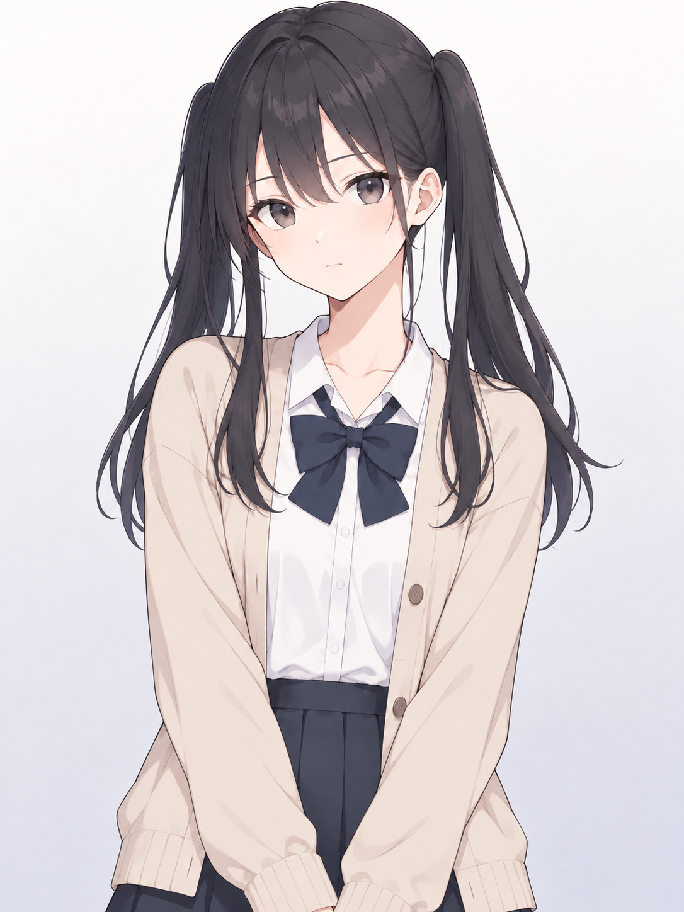
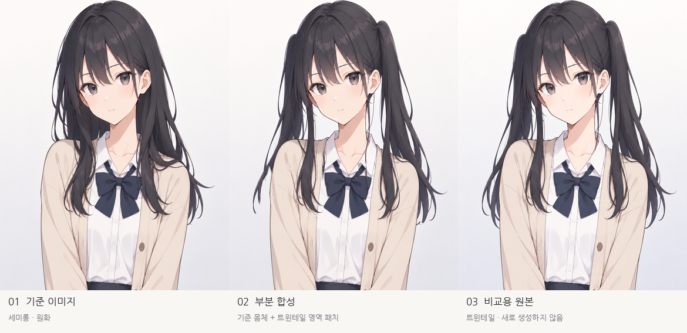
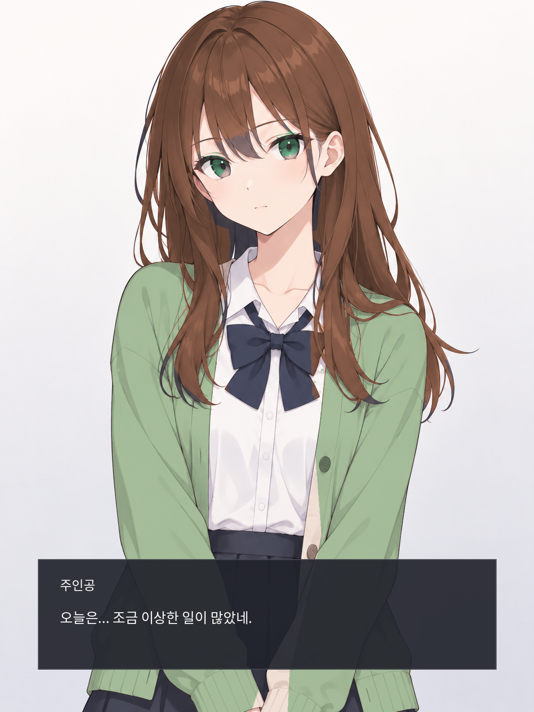

# 캐릭터 아트 제작 명세 — 2D SCG · 3D · 커스터마이징 · Codex 인계

> **v0.5 / 2026-10-25 / 제작 지침·검토안**. 시안/기술 파이프라인의 단일 원본. 이미 승인된 게임 입력·전투는 [02](02_combat.md), [06](06_vertical_slice.md) 참조. **원화 시안과 생산용 독립 파츠·메시·리깅의 완료 상태를 구분한다.**

> **2026-10-25 인계 점검:** 제공된 ZIP의 참조 PNG 7장과 실험 자료를 반입하고 MANIFEST의 20개 파일 체크섬을 확인했다. `9e8aa55`에 커밋했으며 `9b711cd`까지 GitHub `main`에 푸시했다. 실제 치수·이미지 관찰·미제작 파츠는 [인계 점검 기록](handoff_status.md) 참조. 참조 업로드는 독립 파츠/3D 제작 완료를 뜻하지 않는다.

## 0. 구현 범위와 결정 상태

| 항목 | 현재 결정/제안 | 상태 |
|---|---|---|
| 게임 내 캐릭터 | **3D**, Tripo로 초기 모델을 제작하고 별도 후처리 | **[사용자 방향]** |
| 대화 장면 | 실제 **2D 셀 셰이딩 애니메이션풍 상반신 SCG**, 절제된 디테일 | **[사용자 선호·현재 방향]** |
| 외형 커스터마이징 | 헤어스타일·머리색·눈 모양·눈 색상, 평상복/변신복 전환 | **[범위 제안]** |
| 3D 제작 구조 | 경량화·커스터마이징 대응, 변신 상태에서도 복장 변경 | **[2026-10-25 사용자 요구]** |
| 변신복 외형 | 사용자 시안 접수, 공통 몸체용 의상 파츠 준비; 지팡이는 미확정 | **[2026-10-27 시안 접수·최종 승인 아님]** |
| 체형·얼굴형 슬라이더, 안경/액세서리, 옷 부위별 혼합 | 초기 범위에서 **제외** | **[현재 범위]** |
| 2D 제작 방식 | 공통 얼굴/몸체 + 교체 헤어·표정·의상 파츠 + 색상 마스크 | **[목표 구조, 미구현]** |
| **첫 최소 전투 시안** | **기계장치의 마녀 1종 + 단일 3D 전투 필드**, 시나리오/대화창/커스터마이징 UI 제외 | **[사용자 승인·우선 범위]** |

**중요:** 이 문서는 Codex로 넘길 **아트 시스템의 사양과 단계별 검증 기준**이다. 현재 전투 최소 시안의 필수 구현 범위를 무단 확대하지 않는다. SCG 파츠 제작 및 편집기는 **병렬 실험 또는 후속 단계**다.

## 1. 시안 원화 및 실험 결과 — 우선 읽기

### 2026-10-27 변신복 시안 접수 — 지팡이 미확정

사용자가 제공한 [변신복 시안](../assets/reference/character/outfits/transformed_v1/concept_2026-10-27.jpg)을 원본 그대로 보존하고 [파일 기록·제작 준비](../assets/reference/character/outfits/transformed_v1/README.md)를 정리했다. 짧은 남색 케이프·흰 블라우스/풍성한 소매·넓은 허리 벨트·겹치마와 긴 천 장식·남색 부츠가 의상 참조다. **지팡이는 사용자 명시대로 미확정**이며 그림 속 무기를 최종으로 취급하지 않는다. 트윈테일은 별도 헤어 참조다.

현재 v17 공통 얼굴·체형·107본 rest를 보존하고 의상을 피팅한다. 1.75배 표시 크기에서 실루엣과 동작을 먼저 검토한다. 시안 접수 당시 레지스트리 상태는 `concept_received_not_created`였으며, Tripo 원형 반입 당시에는 독립 파츠가 없었다. 후속 분리·보관은 v2, 리깅·교체 검토 후보는 아래 v3 항목을 따른다. 독립 2D 레이어와 변신복/트윈테일의 등록된 런타임 asset은 아직 없다. 평상복 기본 게임과 임시 지팡이는 유지한다. 과거의 변신복 디자인 보류 문구는 2026-10-25 당시 상태다.

### 2026-10-27 변신복 Tripo 원형 반입 — 분리·피팅 전

사용자의 「이거를 마찬가지로 트라이포에서 모델링하고 가져오는게 편하지않겠나싶다」 요청으로 [정면·후면 A포즈](../assets/reference/character/outfits/transformed_v1/tripo_input/README.md)를 준비하고 Tripo H3.1에서 전신 원형을 실제 생성·다운로드했다. 원본 의상 시트와 기존 중학생 인상을 참조했으며 지팡이는 입력에서 제외했다. 후면 후보의 앞 버클/신발 앞모습 반복을 교정한 뒤 두 이미지를 업로드했다. 비공개·Ultra·4K PBR·삼각형 설정, 소비 55크레딧이며 [생성 기록](../assets/reference/character/outfits/transformed_v1/tripo_input/tripo_job.json)에 작업 URL/설정/원본 해시가 있다.

[원형 파일과 검사](../assets/characters/player/3d/source/transformed_v1/README.md)는 메시 1개, **1,947,342삼각형**, 4K 텍스처 3장, 리그/웨이트/액션 0개를 확인한다. GLB SHA-256은 `1ebf2e3826fcb44895ff5fb543c54bbe7aa207eee4a5647e894d423960e14e74`이며 Blender 5.1.1 임포트·텍스처 패킹·저장본 재열기를 확인했다. [정면·후면·사선 리뷰](../reports/transformed_tripo_v1/review.html)는 실제 저장본 base-color 렌더다. 리뷰용 표시 재질만 임시 변경했으며 원본 blend를 덮어쓰지 않았다.

이 파일은 **의상 추출용 통합 전신 원형**이다. 원본을 보존한 작업 복사본에서 의상/트윈테일 분리·경량화·기존 v17 몸체 피팅·107본 웨이트 작업과 다섯 모션 검사를 이어간다. 생성된 새 얼굴/몸체나 리그를 공통 기준으로 채택하지 않는다. 레지스트리 변신복 상태는 `raw_source_generated_not_runtime_ready`, runtime asset은 null이다. 트윈테일도 독립 런타임 파츠로 완성되지 않았다. 최종 디자인·게임 적용·변형·성능 승인은 별도다.

### 2026-10-27 변신복 분리 v2 — 잔여 머리 제거와 트윈테일 보관

사용자가 케이프 아래의 잘못 생성된 머리카락 제거와 향후 커스터마이징용 트윈테일 보관을 요청했다. [v2 작업 시작점](../assets/characters/player/3d/source/transformed_v1/parts_v2/README.md)은 `transformed_parts_source_v2.blend`다. Tripo 정밀 분할에 40크레딧을 사용해 64개 파트를 얻었다. 다운로드 분할본의 좌표/UV가 다시 기록된 것을 발견해, 1,947,342개 삼각형의 일대일 대응으로 **분할 라벨만 원본에 옮겼다**. 최종 source blend를 다시 열어 전체 삼각형·좌표·UV의 정확한 보존과 세 텍스처의 바이트 일치를 확인했다.

케이프 아래 잔여 머리 part 36/37(29,282삼각형)은 현재 조립에서 숨기고 복구용 GLB도 남겼다. [좌우 트윈테일 보관 폴더](../assets/characters/player/3d/source/transformed_v1/hair_library/twintails_source_v1/README.md)는 두 메시만 있는 `.blend`/`.glb`, 162,208삼각형, 패킹한 4K 텍스처 세 장과 해시 매니페스트를 포함한다. GLB의 원본 삼각형/UV 오차 0과 텍스처 일치, 별도 blend 재열기를 검사했다. [전후·의상·보관 머리 리뷰](../reports/transformed_parts_v2/review.html)와 [전달 해시](../reports/transformed_parts_v2/delivery_manifest.json)를 따른다.

원본 트윈테일과 케이프는 실제 연결돼 있었다. 분리 경계가 열려 있고 일부 금색 의상 무늬가 머리 텍스처에 남으므로 보관본을 덮어쓰지 않고 파생본에서 정리한다. 이 두 가닥에는 완성 두피/앞머리가 없으며 새로 생성된 얼굴을 공통 얼굴로 채택하지 않는다. 의상 소스의 경계/안쪽 면·v17 몸체 피팅·경량화·웨이트·다섯 모션 검사는 남아 있다. 레지스트리는 소스 위치만 추가했고 변신복/트윈테일 런타임 asset은 null이다. 원본 GLB/임포트 blend와 v17 시작 파일 해시는 유지했다.

### 2026-10-27 변신복 피팅 v3 — 공통 몸체·다섯 모션 검토 후보

사용자의 「좋아 이어가자」 요청으로 [v3 작성본·인계](../assets/characters/player/3d/source/transformed_v1/fit_v3/README.md)를 만들었다. 현재 수정 시작 파일은 `transformed_fit_v3.blend`, SHA-256 `fb81170648182b8812ab95a5c75bd2feedb9a07c60311aad7284e6fd79cf0a82`다. [1.75배 동작 리뷰](../reports/transformed_fit_v3/review.html)에서 대기·달리기·타격·한 손 캐스팅·경직을 실제 크기와 확대로 볼 수 있다. **기존 29메시·107본 rest·47액션을 보존했고 게임/기본 레지스트리는 변경하지 않았다.**

원본 옷을 13개 의상 메시로 피팅·감면·스키닝했다. 케이프의 머리 절단 경계 6곳에 국소 패치를 넣고, 원본 옷 문양을 유지하며 소매를 기존 팔에 맞췄다. 스타킹/가터 표면은 공통 다리에 피팅하고 안쪽 보강 면을 별도로 추가했다. 팔 영역 전용 웨이트 전송과 표면 그래프 확산을 사용하며, 기존 32개 치마 보조 본과 기존 동작을 그대로 따른다. **의상 94,718 / 보이는 조립체 143,663삼각형**, 최대 8웨이트, 원본 4K 보존·런타임 사본 2K다. 최종 리토폴로지·성능 예산은 미확정이다. 트윈테일 원본은 해시 그대로 보관하고 현재 리뷰는 기존 세미롱을 사용한다.

[Blender 검사](../reports/transformed_fit_v3/blender_validation.json)는 145프레임 데이터 무결성과 대기/달리기 반복 경계 정점 오차 0을 확인했다. [5개 저장 GLB](../reports/transformed_fit_v3/glb_validation.json), [Godot 75자세 GPU 대조·실제 의상 교체](../reports/transformed_fit_v3/godot/godot_validation.json)를 확인했으며 최대 본/의상 표본 오차는 0.10361/0.07974mm다. 실제 평상복→변신복 교체는 뼈대·재생 시점을 보존하고 실패 시 rollback한다. 150장의 모션 화면을 촬영했지만 전투 피해/마나/발동 시계·런타임 블렌딩 검사는 새로 실행하지 않았다. 엔진 exit 0·완료 표시가 있으며 stderr는 사용자 shader-cache 폴더 생성 실패만 남았다. [실행 기록](../reports/transformed_fit_v3/godot/execution.json)은 초기 래퍼 exit 1과 이 진단을 구분한다.

완전한 피팅 몸체와의 실제 삼각형 교차가 rest·다섯 대표 자세 모두 남아 **무관통은 통과하지 않았다.** 달릴 때 치마/긴 천이 올라오는 모습, 케이프와 소매의 연결, 단순한 안쪽 보강 면, 머리/옷 접촉을 사용자와 검토한다. 라이브 천·자기 충돌·임의 자세·최종 외형·최종 예산 승인은 별도다. 지팡이는 미확정이다. [NEXT_OUTFIT](../assets/characters/player/3d/source/transformed_v1/fit_v3/NEXT_OUTFIT.md)과 [전달 해시](../reports/transformed_fit_v3/delivery_manifest.json)를 따른다. v1/v2의 피팅/리깅 전 문구는 해당 원본 단계의 기록이다.

### 2026-10-27 변신복 국소 수정 v4 — 뒷부츠·옷 연결·들림

사용자가 v3의 방향을 좋게 평가하고 뒷부츠가 종아리에 묻히는 부분을 포함한 수정을 요청했다. 현재 수정 시작점은 [v4 README·NEXT_OUTFIT](../assets/characters/player/3d/source/transformed_v1/fit_v4/README.md)과 `transformed_fit_v4.blend`, SHA-256 `e10c833cbcbac17b3d5058fdf11691d134449c277d02739c669e194a7edf4299`다. [수정 전후·뒷모습 동작 리뷰](../reports/transformed_fit_v4/review.html)를 제공한다. v3와 원본/트윈테일 보관본, 29메시·107본 rest·47액션은 보존했다.

부츠 입구는 스타킹 바깥으로 간격을 확보하고 웨이트를 맞췄으며, 원본의 흰 색 번짐이 있던 뒤 입구 122면에 가죽 재질을 별도로 적용했다. 케이프/소매 연결을 보강하고 앞 치마의 여유와 긴 뒤쪽 천의 추종을 조정했다. 열 가지 자세를 사용하는 최대 12mm의 국소 rest-space 보정은 오프라인 피팅이며 실시간 천이 아니다. 의상 94,718/조립체 143,663삼각형·최대 8웨이트는 유지한다.

[부츠/스타킹 전체 검사](../reports/transformed_fit_v4/v4_boot_layers.json)는 다섯 동작 145프레임에서 교차 0을 확인했다. v3은 같은 검사에서 모든 프레임에 교차가 있었고 최대 439면이었다. 같은 정점 기준 달리기7F의 골반 대비 밑단 들림 95분위는 앞 치마 123.8→101.9mm, 긴 천 57.4→31.0mm다. 같은 자세의 치마/몸체 교차 면은 653→372, 케이프/몸체는 504→323으로 줄었다. 왼소매의 일부 자세는 교차 면 수가 늘었으며 어깨 안쪽 등 잔여 접촉이 있어 전체 의상 무관통으로 해석하지 않는다.

[Blender 145프레임](../reports/transformed_fit_v4/blender_validation.json), [5개 GLB](../reports/transformed_fit_v4/glb_validation.json), [Godot 75자세 GPU·실제 교체](../reports/transformed_fit_v4/godot/godot_validation.json)를 확인했다. 최대 본/의상 표본 오차는 0.10361/0.06804mm이며 1.75배 실제 크기/사선 앞/뒤로 225장을 촬영했다. 엔진·래퍼 exit 0, 완료 표시, stderr에는 알려진 shader-cache 경고만 있다. [전달 해시](../reports/transformed_fit_v4/delivery_manifest.json)를 따른다. 게임 기본/레지스트리는 평상복 v17이고 지팡이는 미확정이다. 최종 외형·성능·중간 프레임/블렌딩·임의 자세·새 전투 규칙 검사는 이번 범위에 포함하지 않았다.

### 2026-10-25 연령 인상 수정 — 새 모델링 시안

사용자가 기존 원화가 고등학생처럼 보인다고 지적하여 **중학생 인상으로 수정**하도록 요청했다. 검은 세미롱·회색 눈·베이지 가디건/남색 교복을 유지하면서 짧고 둥근 하관, 작은 어깨, 약 6등신의 전신 비율을 적용한 시안을 제작했다. 구체적인 나이 13–14세와 비율 수치는 이번 생성의 작업 가정이며 설정상 확정 수치가 아니다.

새 시안은 [middle_school_v1 작업 기록](../assets/reference/character/modeling/middle_school_v1/README.md)에 정리했다. 상반신과 전신 정면·좌측면·후면 PNG 4장이 있으며 모두 1086×1448 RGB 완성 이미지다. **새 얼굴/체형은 연령 수정 후보이고, 독립 파츠나 최종 외형 승인을 뜻하지 않는다.** 원본 인계 PNG 7장은 보존한다. 향후 공통 얼굴/몸체 파츠 제작에는 사용자 연령 수정 지시를 우선 반영하되, 서로 다른 생성 이미지의 좌표를 동일하다고 가정하지 않는다.

### 원본 인계 참조

기존 채팅에서 만들어 둔 원화/실험 결과의 **원본 7장**은 **witch_character_art_codex_handoff.zip**에서 아래 경로로 반입했다. **2026-10-25 GitHub 업로드 완료**(`9e8aa55`, `main`의 `9b711cd`에 포함). 아래 경로는 실제 참조 파일이며 생산용 독립 파츠는 아니다.

| 참조 에셋 (ZIP 내부 경로) | 의미 | 제작 상태 |
|---|---|---|
| assets/reference/character/scg/semilong_reference.png | **1086×1448** 세미롱 기준 원화, 검은 머리·차분한 표정·가디건/교복 | **[완성 일러스트, 레이어 분리 아님]** |
| assets/reference/character/scg/twintails_reference.png | **1086×1448** 트윈테일 헤어 참조, 같은 인상/구도를 의도한 별도 생성 원화 | **[완성 일러스트, 레이어 분리 아님]** |
| assets/reference/character/scg/hair_swap_comparison.png | 세미롱 원화 ↔ 델타 패치 합성 ↔ 트윈테일 참고의 비교 | **[한계 확인용]** |
| assets/reference/character/scg/hair_color_variations.png | 머리·눈·옷 색상 변경 실험 | **[마스크 테스트]** |
| assets/reference/character/scg/dialogue_ui_reference.png | 2D SCG와 대사 UI의 분위기 시안 | **[UI 참조, 확정 아님]** |
| assets/reference/character/scg/mask_quality_check.png | 색상 마스크 번짐·의복/얼굴 경계 검사 | **[품질 검사]** |
| assets/reference/character/scg/hair_swap_mask_overlay.png | 이전 합성에서 교체 영역을 시각화 | **[오류 분석]** |

원화·헤어 교체 실험·대화창 시안 미리보기 (참조 PNG를 저장소로 가져온 뒤 표시됨)

<table><tr>
<td><strong>세미롱 기준 원화</strong> </td>
<td><strong>트윈테일 참고 원화</strong> </td>
</tr></table>

**기존 헤어 교체 실험 비교 (독립 파츠가 아닌 델타 패치):**

**대화 UI 스타일 시안:**

**실험 코드 보존:** ZIP의 experiments/previous_hair_swap_not_production 디렉터리는 과거의 마스크/패치/생성 스크립트다. 기존 전환 데모는 **트윈테일 그림을 델타 영역으로 덮어씌운 것**이고 **진짜 독립된 머리카락 PNG 파츠가 아니다**. 부분적인 배경·피부·옷 픽셀이 패치에 포함될 수 있으므로 프로덕션 헤어로 재사용하지 않는다. 제작 성공 사례가 아니라 **어떤 오류를 피할지 보여주는 회귀 실험**이다.

**참조 우선순위:** 세미롱 기준 원화 = 최종 공통 얼굴·자세·어깨 위치의 원점. 트윈테일 원화 = 새 헤어 디자인 **참조**. 색상·대화창 실험 이미지는 완성 품질 보증이 아니다. 새 완성 원화를 반복 생성해 두 장을 바꿔치기하는 것을 **진짜 커스터마이징 구현으로 간주하지 않는다**.

## 2. 2D SCG 파츠의 제작 구조 — [권장 기술 명세]

### 2.1 고정 화면/좌표 계약

- **마스터 캔버스 1086×1448**(기준 원화의 실제 크기)으로 시작. 모든 파츠 PNG는 **동일한 전체 캔버스 크기**, 원점 좌상단 **(0, 0)**, 픽셀 단위 정렬.
- **sRGB PNG + alpha**(배경 투명). 경계 보간·프린지 테스트 필요. 내보낸 이미지에 배경이 남거나 잘린 어깨가 섞이지 않게 한다.
- **고정:** 얼굴 외곽·귀·목·어깨·몸통 기준점, 표정 및 기본 자세, 카메라 각도. 헤어 변형을 위해 이 위치를 움직이지 않는다.
- **변경:** 헤어·홍채·의상·표정 파츠의 콘텐츠. 애니메이션·표정 추가가 원본 바디 메시/픽셀을 임의로 바꾸지 않아야 한다.
- **핵심 난관:** 현재 완성 원화는 머리 아래의 얼굴·귀·목·가디건 일부가 **이미 가려져 있음**. 단순히 머리 픽셀을 지우면 구멍이 남으므로 **보이지 않던 부분을 새로 복원·수정(수작업/인페인팅 검수)**하여 공통 헤어리스 base를 제작해야 한다. **마스크 추출만으로 해결했다고 주장하지 말 것.**

### 2.2 조립 레이어 순서 (뒤에서 앞으로)

| z 예시 | 슬롯 | 역할 |
|---|---|---|
| 10 | hair_back | 얼굴·목·몸 뒤로 들어가는 뒷머리/트윈테일 뒷쪽 |
| 20 | body_base | 공통 몸체·목·피부(머리카락 제거·가림 복원) |
| 30 | outfit | 평상복/변신복의 의상 자체, 머티리얼/문양 |
| 40 | face_base | 고정 얼굴 피부·귀·윤곽·코·피부 그림자 |
| 50 | eyes | 흰자·눈매·홍채·동공·하이라이트; 눈매 및 색 변경은 분리 마스크 |
| 55 | eyebrows | 표정용 눈썹 |
| 56 | mouth | 표정용 입 |
| 60 | hair_front | 앞머리·얼굴을 가리는 옆머리 |
| 70 | hair_over_clothes | 어깨·옷 앞에 내려오는 머리/트윈테일의 앞 가닥 |

위 z는 **구현을 위한 기본안**이다. 개별 캐릭터마다 일부 꼬리가 얼굴 뒤/어깨 앞을 가로지르므로 필요 시 머리 파츠를 front/back으로 더 쪼개고, **눈과 앞머리 가림 순서**를 수작업으로 검수한다. 머리카락 전체를 한 이미지로 만들면서 얼굴과 몸체를 함께 굽는 방식은 금지.

### 2.3 폴더·파츠 이름 계약 (제작 목표, 파일 아직 없음)

~~~text
assets/characters/player/
  scg/
    config/
      appearance.default.json         # ZIP에 제공한 계약 예시
      scg_layers.spec.json           # ZIP에 제공한 레이어 매니페스트 초안
    layers/
      base/
        body_base.png                # hairless common body + neck
      face/
        face_base.png                # ears, skin, nose
        eyebrows/neutral.png
        eyes/neutral_v1.png
        eyes/iris_mask.png
        mouth/neutral.png
      outfits/
        civilian_v1/outfit.png
        civilian_v1/tint_mask.png
        transformed_v1/outfit.png    # 변신복: 후속 제작
      hair/
        semilong_v1/
          back.png
          front.png
          over_clothes.png
          recolor_mask.png
        twintails_v1/
          back.png
          front.png
          over_clothes.png
          recolor_mask.png
    source/                          # 제작 PSD/KRA/Blender 등의 편집 원본
  3d/
    source/                          # Tripo 중간 모델/Blender 원본
    exports/                         # 엔진에 임포트할 FBX/GLB
~~~

ZIP의 config 두 파일과 참조/실험 이미지에 더해 중학생 수정 시안 및 3.2절의 **Tripo 원본 GLB**가 추가되었다. 생산용 개별 레이어 PNG, 최종 PSD/KRA, 공통 리그와 게임용 내보내기는 **아직 없다**. 없는 파츠를 1×1 빈 PNG나 델타 패치로 때워 성공 검사하지 않는다.

### 2.4 헤어 스타일별 조립

- **세미롱:** hair/semilong_v1의 back + front + over_clothes.
- **트윈테일:** hair/twintails_v1의 back + front + over_clothes. 필요 시 왼쪽/오른쪽 꼬리를 별도 이미지로 더 나눠도 된다.
- **모든 스타일의 얼굴·몸체·눈·의상 레이어는 같은 파일**을 공유해야 한다. 다른 완성 일러스트로 몸체까지 갈아 끼우면 테스트 불합격.
- 눈 모양 교체와 변신복은 동일 파이프라인의 후속 항목. **첫 파츠 검증에서는 세미롱↔트윈테일 + 중립 얼굴만** 안정적으로 완성한다.

### 2.5 색상 변경

- 헤어·홍채·의복 **각 파츠별 독립 tint mask**를 사용한다. 선화·명암·하이라이트가 보존되도록 중립 명도 베이스 + 색상 연산을 채택하되 엔진 방식에 종속되지 않게 한다.
- 색상 변경은 **머리·눈·가디건 각 영역에만** 적용한다. 피부·흰자·머리카락 바깥 배경이 착색되면 불합격.
- 원래 완성 원화의 흑색 RGB 픽셀에 단순 곱셈만 해서는 밝은 새 머리색이 제대로 나오지 않을 수 있다. 중립 톤 분리 또는 전용 셰이더로 해결한다.
- 패션 액세서리, 체형 슬라이더, Live2D 리깅은 첫 파츠 검증에 포함하지 않는다.

### 2.6 공통 외형 데이터 — 2D와 3D의 동일 입력

사용자 커스터마이징 데이터는 **한 군데**에만 저장하고 2D SCG와 3D 전투 모델이 같은 키를 소비한다. ZIP의 assets/characters/player/scg/config/appearance.default.json 참고.

~~~json
{
  "schema_version": "0.2-draft",
  "character_id": "player",
  "body_preset": "standard_v1",
  "hair_style": "semilong_v1",
  "hair_color": "#282630",
  "eye_shape": "neutral_v1",
  "eye_color": "#72707A",
  "expression": "neutral",
  "outfits_by_form": {
    "civilian": "civilian_v1",
    "transformed": "transformed_v1"
  },
  "form": "civilian"
}
~~~

- hair_style을 twintails_v1으로 바꾸면 **2D 파츠 세트**와 **3D 헤어 메시 프리셋**이 각각 교체된다.
- hair_color/eye_color는 각각 2D tint mask와 3D의 전용 머티리얼(또는 셰이더 파라미터)에 적용된다.
- `form`은 현재 변신 상태이며 `outfits_by_form`은 각 상태에서 마지막으로 선택한 의상이다. 현재 의상은 `outfits_by_form[form]`으로 계산한다. 변신 중 다른 변신복을 골라도 `form`은 유지하며, 변신 해제·재변신 및 저장/불러오기 후에도 각 선택을 보존한다. 2D/3D는 이 동일 입력을 사용한다. 첫 전투 시안에 교체 UI를 추가하는 요구는 아니다.
- `outfit`을 별도로 저장하여 상태가 어긋나게 하지 않는다. `tools/character_appearance.py`가 기존 `0.1-draft` 입력을 변환하고, 기존 SCG 로더용 `outfit`은 읽기용 어댑터로만 계산한다. 새 의상은 3D 레지스트리와 해당 2D 레이어 명세에 각각 추가해야 하며, 미등록 의상을 조용히 다른 것으로 대체하지 않는다.
- 프리셋 키/파일 경로에 하드코딩된 미구현 스타일이 있어도 실행할 때 조용히 실패하지 않도록 검증·fallback을 정의한다.

### 2.7 공통 캐릭터 위에 진짜 헤어를 바꾼다는 성공 기준

1. 세미롱과 트윈테일의 **눈·귀·목·어깨·옷의 픽셀 위치가 완전히 동일**하고, 머리 레이어만 바뀐다.
2. 머리색을 바꿔도 양쪽 모두 그림자·선화가 자연스럽다. 눈·피부·의상 색은 영향을 받지 않는다.
3. 머리카락 끝/귀/눈썹/카라/어깨의 경계에서 배경색 잔상, 타 스타일 머리 조각, 얼굴 가림 구멍이 없다.
4. 머리·눈·의상을 바꾼 뒤에도 동일한 표정과 대화 UI 배치가 유지된다.
5. PNG 합성 결과와 appearance JSON을 내보내며 **왕복 로딩** 시 같은 화면을 재현한다.
6. **기존 experimental delta mask를 끈 상태**에서도 독립 헤어 레이어만으로 렌더링되어야 한다.

## 3. Tripo 기반 3D 캐릭터 아트 — [사용자 방향·제작 제안]

### 3.1 아트 우선순위

- **2D SCG 기준 원화가 비주얼 기준(디자인 원본)**이다. 전투용 3D 캐릭터는 그 **실루엣/헤어형/의상색**과 애니풍 인상을 보존해야 한다.
- 전투는 **3D 쿼터뷰**이고 인물이 작게 보인다. 얼굴 세부 묘사보다 **헤어 실루엣·변신복 형태·무장/스킬 모션 가독성** 우선.
- **2026-10-25 사용자 검토 기준:** 원본도 확대하면 얼굴 텍스처와 머리카락에 아쉬움이 있으나, 실제 화면에서는 캐릭터가 작으므로 확대 디테일에 과도하게 투자하지 않는다. 다음 품질 판단은 **실제 전투 카메라의 표시 크기**에서 한다. 실루엣·색 구분·움직임에서 보이는 깨짐/깜빡임/관통을 우선 수정한다.
- **표시 크기 1차 검토:** [실제 전투 카메라 비교](../reports/character_display_scale/README.md)에서 원본·4만 v2·8만 v2를 같은 조명/카메라의 1280×800 화면으로 렌더했다. 기존 임시 캐릭터의 몸 높이에 맞춘 **1.70 게임 단위 가정**에서 기본 카메라의 캐릭터 높이는 약 **63px**, 비교용 2배/4배 카메라는 약 **126px/253px**다. 기본 크기에서 후보 간 차이는 작게 보이나 밝은 얼굴/가디건의 명암 구분도 검토해야 한다. 본 게임을 수정하지 않은 독립 정지 장면이며 최종 신장·폴리곤 예산·품질 승인이나 움직임 검증은 아니다.
- **확대 연출은 미정:** 사용자는 연출상 필요하면 가까이 보여 줄 가능성을 열어 두었다. 확대 장면이 없다고 확정하지 않는다. 원본과 8만 후보를 보존하고, 근접 연출의 구도/크기를 정하면 그 조건으로 얼굴·머리카락 품질을 다시 검수한다. 현재는 확대 디테일 추가보다 공통 리그·교체 파츠·변형 검증을 우선한다.
- **캐릭터 제작 표시 크기 — 사용자 채택:** 기본 63px 화면이 작다는 검토 후 [확대 비교](../reports/character_display_scale/camera_framing_v2/README.md)의 **1.75배를 캐릭터 작업 기준으로 채택**했다(2026-10-25). 동일한 1280×800 / 직교 사선 카메라에서 캐릭터 높이는 약 **111px**이며 `Camera3D.size=20/1.75≈11.4286`이다. 제작/검수 도구용 값은 [display_review.spec.json](../assets/characters/player/3d/config/display_review.spec.json)에 기록했다. 기존 신장 1.70 게임 단위는 이 화면을 재현하기 위한 배율 가정이며 설정상 신장 확정이 아니다. **2026-10-28 사용자가 게임 속 신장을 1.5m로 정했다.** 원본·내보내기 GLB와 리그는 그대로 두고, 본 게임의 표현 제어기가 모형 전체를 1.5/1.711배로 줄이며 카메라도 같은 배율로 당겨 약 111px 표시 크기를 유지한다([실행 안내](godot_prototype.md)). 아트 검수 도구는 여전히 원래 크기 모형과 `20/1.75` 카메라를 쓴다. 본 게임 적용은 게임 작업자 영역이고, 시야·적 배치·사거리 검수 및 근접 연출 도입 여부는 별도다.
- **셀 셰이딩, 단순한 명암 단계와 절제된 텍스처 디테일**을 목표로 한다. 구체적 셰이더/렌더 파이프라인은 게임 엔진 확정 뒤 선택한다.

### 3.2 Tripo → Blender → 엔진 파이프라인

1. **디자인 준비:** 기존 SCG 원화와 별도로 제작하는 **A-포즈 또는 T-포즈 전신 정면/측면/후면 참고도**를 만든다. 지금의 상반신 원화만 넣고 원하는 게임용 전신 메시·옷 파츠가 자동 완성된다고 기대하지 않는다.
2. **Tripo 모델 생성:** 먼저 **체형·비율이 고정된 기본 휴머노이드 1개** 제작. 가능한 경우 부품 분리·적절한 폴리곤 수·리토폴로지·텍스처 분리 수행.
3. **Tripo 자동 리깅:** 사람형 스켈레톤을 생성하고 어깨/팔꿈치/엉덩이/손 관절을 미리 확인. Tripo 공식 권고처럼 **FBX가 스켈레톤/애니메이션 교환에 적합**하며 GLB도 런타임 포맷 후보. 기계적인 움직임은 블렌더에서 재검증.
4. **Blender 정리:** 공통 스켈레톤 기준점, 메시 스킨 웨이트, 의상 교차, 헤어/눈/옷의 교체 지점을 정돈. 생성된 자동 리깅이 완성품이라고 가정하지 않는다.
5. **헤어 프리셋:** 3D 헤어 메시를 semilong/twintails 형태로 별도 장착, 동일 두상과 머리 기준 본에 결합. 긴 트윈테일은 단순 정적 헤어로 시작해 필요 시 추가 본/헤어 카드/간단한 애니메이션을 후속 제공.
6. **얼굴/색:** 눈 모양은 교체 가능한 메시/텍스처 프리셋, 눈동자색과 머리색은 전용 머티리얼 파라미터. 원본 통짜 텍스처를 일괄 tint해서 피부·눈흰자까지 물들이지 않는다.
7. **변신 전후:** 평상복/변신복 **두 의상 세트**를 같은 스켈레톤에 스키닝하여 교체. 기존 캐릭터 리그와 애니메이션을 교체하지 않는다. 소매/치마/어깨/허리·머리카락 교차를 확인.
8. **엔진 임포트·실전 테스트:** idle, run, melee attack, ranged attack, hit, death, transformation 샘플 애니메이션에서 각 머리·의상이 이상 없이 동작하는지 확인. 첫 전투 필드는 Godot 4.6으로 착수했으나([실행 안내](godot_prototype.md)), 실제 캐릭터 임포트·리그·셰이더는 자산 도착 뒤 검증한다.

**지원 범위 확인(2026-10):** Tripo 공식 문서는 Humanoid 자동 스켈레톤/웨이트와 FBX/GLB 내보내기를 설명한다. **지원 = 교체형 헤어·의상 리깅 결과가 자동으로 완성된다는 뜻은 아님**. 관련 문서: [Tripo Rigging & Animation](https://www.tripo3d.ai/product-doc/module-post-processing/rigging-animation), [Tripo Export](https://www.tripo3d.ai/product-doc/export-and-integration/export-dcc), [Auto Rig API](https://developers.tripo3d.ai/en/docs/animations-rig), [Blender Armature Modifier](https://docs.blender.org/manual/en/latest/modeling/modifiers/deform/armature.html), [Blender Data Transfer](https://docs.blender.org/manual/en/4.5/modeling/modifiers/modify/data_transfer.html).

### 3.3 3D 커스터마이징의 현실적인 1차 구현

| 범위 | 구현 | 이번에 제외 |
|---|---|---|
| 머리 | **완성 헤어 메시 프리셋 교체** + 색상 머티리얼 | 머리 길이/가닥 개별 물리 슬라이더 |
| 눈 | **눈매 프리셋** + 홍채 색 머티리얼 | 얼굴 전체 변형·본격 모핑 |
| 몸체 | **고정 체형 하나**, 공통 스켈레톤 | 키/체형 슬라이더 |
| 의상 | **평상복/변신복 각각의 전체 세트 선택**, 변신 상태에서도 다른 변신복 세트로 변경 | 상의/하의/소매 자유 믹스매치 |
| 액세서리 | 미래 옵션 | 안경/리본/장식 슬롯 초기 구현 |
| 물리 | 정적 머리/본 기반 간단한 동작 | 머리·치마의 고급 물리 시뮬레이션 |

**검증 포인트:** 의상 교체 버튼 자체가 아니라 **동일 애니메이션 클립에서 몸체·옷·헤어가 관통 없이 움직이는가**가 핵심. Tripo가 생성한 체형/리그를 헤어 스타일별로 매번 새로 만들지 않는다.

**현재 3D 에셋 상태(2026-10-25 추가 작업):** 원래 ZIP에는 3D 파일이 없었으나, 중학생 수정 정면 원화로 Tripo H3.1 초안 1개를 실제 생성했다(비공개, 55크레딧). [원본·검사 기록](../assets/characters/player/3d/source/middle_school_v1/README.md)에 GLB와 Blender 임포트 파일을 보관했다. Blender 5.1.1에서 **메시 1개, 1,980,284 삼각형, 4K 텍스처 3장, 리그/웨이트/애니메이션 없음**을 확인했다. 헤어·의상은 독립 교체 파츠가 아니며 게임에 넣기 전 폴리곤 수 조정·분리·리깅·변형 검수가 필요하다. 원화의 연령 인상과 모델 외형도 최종 승인 전 시안이다.

### 3.4 경량화·모듈 교체 구조 착수 (2026-10-25)

**실제 산출물:** [경량화 비교 기록](../assets/characters/player/3d/source/middle_school_v1/optimization_trial/README.md)에 39,999/19,999 삼각형 GLB와 Blender 작업 파일, 같은 카메라의 원본/경량화 렌더, 재임포트 검사 결과가 있다. 4만·2만은 이번 비교용 수치이며 최종 예산으로 승인된 값이 아니다. 기존 4K 텍스처는 비교본에서 2K로 줄였다. 기존 노멀맵은 토폴로지 변경 후 잡티가 보여 비활성화했으며 재베이크가 남아 있다. **단순 감면한 통합 메시를 모듈형 캐릭터나 애니메이션용 리토폴로지로 간주하지 않는다.**

동일 위치를 1e-6 단위로 합쳐 연결성을 검사하면 원본은 하나로 이어진 표면이다. 몸·옷·머리의 의미별 분리는 자동으로 준비된 상태가 아니다. 옷 아래의 공통 몸체와 머리 아래 두상은 별도 제작·복원이 필요하다.

**후속 사용자 검토:** 2만 비교본은 너무 거칠어 후보에서 제외하고, 4만도 특정 손 부위가 아니라 **캐릭터 전체 품질을 추가 수정**한다. 4만을 고정 목표로 승인하지 않았다. [전체 품질 재검토 v2](../assets/characters/player/3d/source/middle_school_v1/optimization_trial/quality_refinement_v2/README.md)에는 원본 4K 색 텍스처 유지·표면 노멀 재계산을 적용한 4만 재비교본과 8만 후보를 보관했다. 8만은 형태 보존 비교용 새 후보이며 최종 예산/품질 승인이 아니다.

- **공통 기준:** 한 몸체·한 휴머노이드 리그·동일 기준 포즈/바인드 행렬을 유지한다. 의상을 바꿀 때 리그 인스턴스나 재생 중인 애니메이션, 위치, 전투 상태를 교체하지 않는다.
- **파츠:** 몸체/헤어/눈/의상 슬롯을 분리한다. 의상마다 가릴 몸체 영역을 명시하고 몸체 원본 자체를 삭제하지 않는다. 머리색·홍채색은 독립 영역에만 적용한다.
- **LOD:** 모든 단계가 파츠 경계, 리그 바인딩, 색상 영역을 유지해야 한다. 분리·리깅 후 실루엣과 어깨/소매/치마 변형을 다시 검사한다.
- **교체 절차:** 새 세트 전체 로드 → 바인딩·재질·가림 영역 검증 → 한 번에 교체한다. 누락/불일치 시 기존 의상과 캐릭터 상태를 유지한다. 현재 작성한 Python 도구는 이 절차의 입력/로드 계획을 제공하며 런타임 렌더 교체 구현은 아니다.
- **착수 당시 상태:** 처음에는 [모듈 레지스트리](../assets/characters/player/3d/config/modular_character.spec.json)의 모든 파츠 경로가 `null`이었다. 이후 §3.6의 v7에서 실제 검증한 몸체·세미롱·눈·평상복 경로를 등록했다. `transformed_v1`과 트윈테일은 여전히 미제작이다. 경량화 통합 비교본은 이 레지스트리에 교체형 파츠로 등록하지 않는다.

`tests/test_character_appearance.py`는 변신 상태의 의상 선택 변경, 해제/재변신/직렬화 후 선택 보존, 공통 외형 보존, 잘못된 폼/몸체/리그 거부, 누락 자산 차단 및 2D/3D 동일 의상 선택을 검증한다. 이는 실제 의상 메시의 변형/관통/성능 검수를 대신하지 않는다.

### 3.5 공통 몸체·리토폴로지·시험 리그 제작 이력

아래 v1~v13의 상태와 레지스트리 안내는 각 단계 당시의 기록이다. 사용자가 선택한 현재 달리기와 다음 의상 작업 시작점, 게임 연결 검증 상태는 §3.13을 따른다.

**작업 기준:** 사용자 채택 크기인 1.75배 / 약 111px에서 실루엣·연령 인상·색 구분·동작을 검수한다. 원본/8만 비교본은 형태 참조로 보존한다. 통합 Tripo 메시에는 의상 아래의 완전한 몸체나 머리 아래 두상이 없어 별도 제작이 필요했다.

**2026-10-25 첫 제작 결과:** [공통 몸체·시험 리그 v1](../assets/characters/player/3d/source/middle_school_v1/common_body_v1/README.md)에 실제 `.blend`/`.glb`와 검수 이미지를 저장했다. 새로 작성한 연결 케이지 기반 몸체 **14,864 삼각형**, **22본 시험 FK 리그**, 관절/달리기/공격용 진단 클립 3개가 있다. 경계/비다양체 엣지·고립 정점·미할당 웨이트는 0이며 별도 Blender 재임포트와 Godot 1.75배 화면에서 클립 적용을 확인했다. 이는 **공통 몸체와 시험 리그의 첫 초안**으로, 손가락/얼굴 조형·관절 볼륨·UV/텍스처·접지/전투 애니메이션 보정이 남아 있다. 의상/헤어는 미제작이고 생산용 모듈 레지스트리는 계속 미완료 상태다.

**현재 수정본 — 어깨 v2:** 사용자의 어깨 피드백에 따라 [공통 몸체 v2](../assets/characters/player/3d/source/middle_school_v1/common_body_v2/README.md)에서 목 밑 폭, 어깨 볼륨·겨드랑이 루프와 몸통/쇄골/위팔 웨이트를 다듬었다. 본의 기준 위치와 **22본 / 14,864 삼각형은 유지**하고 쇄골이 함께 움직이는 어깨 진단 클립을 추가했다(총 4클립). [동일 위팔 회전의 수정 전후 렌더](../assets/characters/player/3d/source/middle_school_v1/common_body_v2/previews/shoulders_before_after.png), 별도 GLB 재임포트, Godot 1.75배의 9개 포즈 캡처가 있다. 수평 팔의 어깨 꺼짐/돌출은 줄었으나 머리 위 자세의 어깨·겨드랑이 볼륨과 골반·무릎·접지는 후속 대상이다. **완성 리그/파츠로 승인된 상태가 아니며** v1 원본과 생산용 레지스트리의 미완료 상태를 보존한다.

**현재 실험본 — 표준 변형 방식과 PSD v3 (2026-10-26):** 사용자의 기존 리깅 방법 조사 요청에 따라 [어깨·골반 방식 비교 v3](../assets/characters/player/3d/source/middle_school_v1/rig_method_study_v3/README.md)를 만들었다. 동일한 v2 몸체에 자동 웨이트, Preserve Volume(DQ), Corrective Smooth를 비교하고, **DQ + Corrective Smooth의 결과에서 자세별 보정 셰이프 12개를 자동 계산**했다. 기본 메시·웨이트와 14,864삼각형을 유지하며, 22본 제작 리그에서 비변형 root를 제외한 21본과 5개 진단 클립을 GLB로 내보냈다. 별도 Blender 재임포트 및 Godot 1.75배의 13개 포즈에서 모프 동작을 확인했다. **큰 비틀림·복합 자세·임의의 새 클립에 대한 자동 구동·의상 보정 전달은 미완료**다. 이후에는 기본 메시를 반복 조형하기 전에 표준 변형 방식과 자세별 보정을 먼저 검토한다. 자세한 설정, 비교 이미지, 근거 자료와 재베이크/내보내기 도구는 해당 README에 있다. 완성 모듈로 등록하지 않는다.

**비틀림·복합 자세 검수 v4 (2026-10-26):** [진단 동작과 결과](../assets/characters/player/3d/source/middle_school_v1/rig_stress_test_v4/README.md)에 어깨/골반 축 회전 및 복합 동작 4개를 추가했다. v3의 기본 메시·웨이트·보정 12개를 유지한 **564프레임 시험**이며, Godot 1.75배와 확대 시점의 움직이는 비교가 있다. 큰 회전에서 어깨 꺼짐과 골반 접힘이 남고, 순수 위팔 비틀림에도 앞으로 뻗기 보정이 최대 약 72% 켜지는 구동기 문제가 확인됐다. **변형 검수는 수정 필요**이며, v4를 개선 모델이나 완성 리그로 간주하지 않는다. 다음 우선순위는 swing/twist 분리 → 회전 분산 본 비교 → 실제 동작 범위의 추가 보정이다. 검수 도구의 클립 전환 시 이전 자세 잔류도 수정하여 v3/v4 엔진 캡처를 다시 생성했다.

**현재 검토 후보 — Rigify + 연속 비틀림 v5 (2026-10-26):** [기존 구현 적용 기록](../assets/characters/player/3d/source/middle_school_v1/rigify_trial_v5/README.md)과 [최신 비교/파일](../assets/characters/player/3d/source/middle_school_v1/rigify_trial_v5/continuous/README.md)을 따른다. 설치된 Rigify의 팔·다리 생성기를 사용해 각 구간을 실제 변형 본 3개로 나눴다. 기본 몸체 형상과 **14,864삼각형은 유지**, 게임용 **37본 / 최대 4웨이트 / 보정 셰이프 0개**다. 기본 Rigify에서도 극단 복합 자세의 회전 보간이 뒤집혀, 생성된 16개 중간 tweak 본에 swing/twist 분리와 연속 각도 베이크를 적용했다. 같은 복합 동작의 최대 로컬 본 회전 변화가 153.52°에서 5.11°/프레임으로 줄었고, 9클립 850프레임의 베이크 및 Godot 1.75배·확대 시점에서 대조했다. **기존 9클립에 대한 베이크 후보**이며 임의의 새 포즈를 자동 해결하는 라이브 드라이버가 아니다. 큰 비틀림의 어깨·골반 눌림은 줄었지만 복합 어깨/겨드랑이·골반의 국소 접힘과 의상 전달은 남아 있다. 최종 공통 골격 승인·생산용 등록·본 게임 반입은 하지 않았다.

**권장 실행 순서:**

1. **공통 몸체 형태와 관절 위치:** 중학생 인상의 얼굴/머리 비율·어깨 폭·팔다리 길이를 맞춘 대칭 A포즈 몸체를 만든다. 옷·헤어와 독립된 두상/몸체로 만들고, 가려진 표면을 복원한다. 얼굴형/체형 슬라이더는 이번 범위에 추가하지 않는다.
2. **변형용 메시 구조:** 어깨·팔꿈치·골반·무릎을 접었을 때 형태가 유지되도록 면 흐름을 설계한다. 공통 몸체는 처음부터 가벼운 메시로 구성할 수 있으며, 불필요하게 고밀도 조형 후 다시 감면하는 단계를 강제하지 않는다. 기존 Tripo 표면에서 재사용할 부분은 새 변형용 메시로 리토폴로지한다. 자동 감면/리메시만으로 완료 처리하지 않는다.
3. **시험 리그와 웨이트:** `player_humanoid_v1` 공통 골격을 만들고 기본 웨이트를 준다. 팔 들기·팔꿈치/무릎 굽히기·골반 회전·달리기/공격 포즈에서 눌림과 찢어짐을 확인하고 메시/웨이트를 함께 고친다. 자동 웨이트는 출발점이며 변형 검수를 통과해야 한다.
4. **표면·공통 파츠 정리:** 메시 구조가 안정된 뒤 UV/색상 영역·텍스처를 정리하고 리그/기준 포즈/바인드 행렬을 고정한다. 몸체 원본은 보존하며 의상별 가림 영역으로 노출을 제어한다.
5. **의상·헤어와 교체 검증:** 독립 평상복/헤어를 같은 골격에 연결하고 동일 포즈에서 관통을 확인한다. 변신복 디자인은 보류 상태로 유지하며, 임시 교체 검증물은 최종 변신복으로 등록하지 않는다. 폼별 선택 보존과 변신 중 복장 변경 계약은 유지한다.
6. **엔진 확인·LOD:** GLB 재임포트에서 뼈/웨이트/재질/좌표를 확인하고, 1.75배 기준 정지 화면과 동작에서 검사한다. 실제 움직임과 교체가 안정된 뒤 LOD별 폴리곤 예산을 검토한다. 4만/8만 중 어느 것도 최종 예산으로 확정하지 않는다.

**첫 완료 단위:** 공통 몸체 1개 + 시험 리그 1개 + 관절 변형 검수였다. v5의 개선을 사용자 검토한 뒤 얼굴·손과 평상복·머리를 추가하는 §3.6 작업으로 진행했다.

기술 근거: Blender는 변형할 메시의 리토폴로지 필요성을 설명하며, 자동 웨이트 결과에도 수동 보정이 필요할 수 있다고 안내한다. [리토폴로지](https://docs.blender.org/manual/en/4.0/modeling/meshes/retopology.html), [Armature Deform / Automatic Weights](https://docs.blender.org/manual/en/4.1/animation/armatures/skinning/parenting.html).

### 3.6 교체형 평상복 v7 — 실제 자산과 인계 (2026-10-26)

사용자의 「의상과 머리까지 기존 Tripo 디자인으로 교체 가능한 완성본을 준비하고, 변신복은 다음에 제작」 요청에 따라 [v7 제작 파일·검증 기록](../assets/characters/player/3d/source/middle_school_v1/modular_civilian_v7/README.md)을 만들었다. **이 단계 당시 의상 제작 시작점은 `modular_civilian_v7_ready.blend`**였으며, 당시 [다음 의상 작업 안내](../assets/characters/player/3d/source/middle_school_v1/modular_civilian_v7/NEXT_OUTFIT.md)를 보존한다. 현재 시작점은 §3.11이다. 원본 Tripo와 이전 단계는 보존했다.

- **실제 공통 자산:** 두상·중립 얼굴·귀·다섯 손가락과 가려진 몸체를 구성했다. 몸체는 7개 상보적인 가림 영역으로 분할하고, 별도로 전체 피팅용 몸체를 넣었다. 세미롱·홍채·평상복은 독립 메시이며 같은 83본/바인드 행렬을 사용한다. v5의 37개 몸체 본에 손가락 30개와 치마 보조 16개를 추가했다. 최대 4웨이트, 보정 모프 0개다.
- **외형:** 원본의 회색 세미롱·베이지 가디건·흰 칼라·남색 리본/치마/니삭스·갈색 로퍼를 따른다. 상의/치마/양말을 움직임과 교체에 맞춰 재구성했으므로 원본 메시 자체의 복제본은 아니다. 중학생 인상과 최종 외형 승인은 사용자 검토 전이다.
- **실제 파일:** `3d/exports/modular_v7/`의 몸체 23,424·머리 25,209·눈 864·의상 15,560삼각형 GLB와 가려진 몸체를 제외한 **57,885삼각형 조립 GLB**가 있다. 이미지 3장, 최대 2K, LOD 한 단계다. 이 수치를 프로젝트 고정 예산으로 승인하지 않는다.
- **검수:** [검수 페이지](../reports/modular_civilian_v7/review.html)에 실제 1.75배/1280×800 화면(실루엣 약 110.5px), 정면·측사면·후면과 움직임을 모았다. 5개 GLB의 본/웨이트/바인드/텍스처 검사, 별도 Blender 재임포트와 제작 파일 재열기, Godot 4.6.2의 11진단 클립/87샘플을 확인했다. Blender와 Godot 본 머리 위치의 최대 차이는 약 0.0000074단위다.
- **교체:** 독립 [런타임 어댑터](../tools/modular_character_runtime.gd)에서 같은 Skeleton·몸체·AnimationPlayer·시간·위치를 유지한 채 파츠를 교체한다. 누락 파일·다른 리그·잘못된 가림 영역은 이전 상태를 유지한다. 의상/머리 제거와 복원, 독립 머리색/홍채색 변경을 실제 렌더로 확인했다. 기본 appearance 색은 원본 색을 유지한다. 본 게임의 전투 상태와 연결하는 작업은 별도이며 `game/`은 수정하지 않았다.
- **미완료 경계:** 변신복·트윈테일은 `asset: null`, 2D 독립 레이어는 미제작이다. 근접 머리 표면의 거친 부분, 표정/립싱크, 손 IK, 머리 물리, 라이브 천 시뮬레이션, 추가 LOD와 최종 전투 모션은 남아 있다. 치마는 허벅지 방향에 따른 보조 본 동작을 1,020프레임에 베이크했으며 새 클립/새 의상에서는 재베이크·관통 검수가 필요하다. 11클립은 진단용으로, 임의 자세의 무관통이나 최종 모션을 보증하지 않는다.

### 3.7 얼굴 조형·체형 보정 v8 — 후보 (2026-10-26)

사용자가 v7이 원본보다 얼굴 조형과 체형에서 완성도가 떨어진다고 지적했다. 원인은 v7 두상이 원본보다 25~40mm 뒤에 놓인 타원 회전체였고, 몸체가 절차적 마네킹이었기 때문이다. [v8 기록](../assets/characters/player/3d/source/middle_school_v1/modular_civilian_v8/README.md)은 두상을 원본 피부면에 맞춰 다시 만들고(V자 턱·콧대·옆얼굴·둥근 두개골), v7 정리 얼굴 그림을 그 위로 옮겼다. 다리·양말은 원본 단면에 맞추고 몸통에 해부학적 보정을 했다. 이어 사용자가 어깨가 어색하다고 지적했다. 원인은 리그 팔이 원본보다 넓게 벌어진 것(팔꿈치 4.4cm, 손목 4cm 바깥)이었다. 사용자 결정으로 팔 본의 기준 자세를 원본 팔 위치로 옮겼다. 본 이름·개수·클립은 같지만 바인드 행렬이 바뀌어 리그 ID가 `player_humanoid_v8`이고 v7 파츠와 섞어 쓸 수 없다. GLB 구조 검사와 새 기준값의 Godot 4.6.2 87샘플·교체 검사를 통과했다. 조립 GLB는 64,505삼각형이다. **사용자 외형 승인 전이라 레지스트리와 다음 의상 시작 파일은 아직 v7이다.** 원본 대비 가장 큰 남은 차이는 v7 그대로인 평상복(상자형 가디건, 주름 없는 치마, 빠진 단추·립)과 v7 정리본의 작은 눈이다.

### 3.8 원본 의상 표면 재사용 비교 v9 (2026-10-26)

사용자의 원본 옷 재사용 요청에 따라 [원본 의상 이식 비교](../reports/source_outfit_v9/review.html)와 [Blender 작업본/기록](../assets/characters/player/3d/source/middle_school_v1/source_outfit_v9/README.md)을 만들었다. 원본을 보존한 `civilian_80k_v2.glb`에서 상의 35,245·치마 12,393삼각형을 원래 표면·UV·4K 색상으로 분리해 **v8의 몸체와 리그에 연결**했다. 가디건 단추·소매/밑단 골지·셔츠와 치마 주름이 보존된다. v8 얼굴·몸체·손·머리·눈·피팅 몸체의 정점 위치 서명과 83본 기준 행렬은 변하지 않았고, 기존 양말/구두를 유지했다.

**검토용 비교본이며 완성 파츠는 아니다.** 원본의 융합된 겨드랑이/허리 표면이 큰 팔 회전에서 늘어진다. 보이는 원본 표면은 유지하고 해당 연결부·머리 아래 의상 면과 웨이트를 국소 보완한다. 전체 경계 메우기/복셀 리메시 실험은 다시 적용하지 않는다. v8 원본·기본 레지스트리는 유지하며, v9에는 아직 Godot 교체 검증이나 본 게임 반입을 하지 않았다.

### 3.9 원본 의상 웨이트 개선 v10 — 검토 후보 (2026-10-26)

사용자의 「원본 옷 디테일을 유지하고 겨드랑이·허리 늘어짐을 고친 뒤 큰 동작으로 비교」 요청에 따라 [v10 작업본·재현 기록](../assets/characters/player/3d/source/middle_school_v1/source_outfit_v10/README.md), [전후 검토 페이지](../reports/source_outfit_v10/review.html), [확대 비교 PNG](../reports/source_outfit_v10/compare.png), [복합 어깨 동작 GIF](../reports/source_outfit_v10/motion.gif)를 만들었다. **이번 후보의 후속 작업 파일은 `source_outfit_v10.blend`이며, 등록된 기본 자산과 v7의 `NEXT_OUTFIT.md`를 갱신한 것은 아니다.** v10은 `player_humanoid_v8` 바인딩을 사용하므로 v7 파츠와 혼용하지 않는다.

- **원본 보존:** 상의의 스킨 웨이트만 바꿨다. 이동한 원본 정점 0개, 토폴로지·UV 동일이며 단추·소매/밑단 골지·리본·주름과 작성용 4K 색상을 유지했다. v8 보호 메시 12개의 정점 수/위치 서명과 83본 기준 행렬도 동일하다. 상의는 최대 8웨이트, 나머지는 최대 4웨이트다. 4개로 줄이면 다시 변형 검수가 필요하다.
- **기존 방법 적용:** [Epic 의상 웨이트 전사 안내](https://dev.epicgames.com/community/learning/tutorials/Dl20/unreal-engine-panel-cloth-transfer-skin-weights-node)와 [Robust Skin Weights Transfer via Weight Inpainting 저자 자료](https://www.dgp.toronto.edu/~rinat/projects/RobustSkinWeightsTransfer/)를 조사했다. 신뢰할 수 있는 대응만 전사하고 나머지를 보간한다는 원리를 사용하되, 이 Tripo 표면에서는 **계산용 carrier의 0.5mm 병합과 7.5mm 공간 그래프에 harmonic 보간을 적용한 변형**을 채택했다. 실제 보이는 메시를 병합·리메시한 것이 아니며, 원 논문의 정확한 구현이라고 부르지 않는다.
- **변형 검사:** Blender에서 11개 진단 클립·1,020프레임의 정점 유한값과 엣지 변형을 검사했다. 어깨 복합 85F의 4배 초과 늘어남은 1,083→166엣지, 10배 초과는 71→8엣지로 줄었다. 같은 몸체·자세·카메라의 실제 렌더를 비교했으며, 이 수치는 특정 자세의 늘어남 지표이지 무관통이나 천 물리의 보증이 아니다.
- **내보내기·엔진 검사:** [5개 GLB 검사](../reports/source_outfit_v10/glb_validation.json)와 [Godot 4.6.2 검사](../reports/source_outfit_v10/godot/godot_validation.json)를 통과했다. Godot에서 11클립·87개 본 자세 샘플, 상의 8웨이트 임포트, 같은 인스턴스/재생 시간/위치를 유지하는 파츠 교체를 확인했다. 상의 런타임 웨이트 합의 최대 오차는 약 0.000106826이다. 가시 조립본은 **102,034삼각형**이고 런타임용 텍스처 복사본만 2K로 축소했다. 최종 경량화·성능 예산 승인을 뜻하지 않는다.

**남은 문제:** 극단적인 어깨 회전에서 겨드랑이 당김과 접힌 선이 일부 남는다. **이번에 변경하지 않은 치마는 깊은 골반 복합 자세에서 심한 늘어남·안쪽 면 노출·관통이 남아 있다.** 전체 의상의 임의 자세 통과나 최종 외형 승인으로 기록하지 않는다. 기본 appearance 레지스트리와 본 게임 `game/`은 변경하지 않았으며, 다음 국소 검토는 남은 겨드랑이와 치마 변형이다.

### 3.10 가디건 분리·원본 치마 지지 개선 v11 — 검증된 검토 후보 (2026-10-26)

원본 주름을 유지하며 큰 골반 동작을 개선하고, 허리 회전에서 가디건이 몸에 붙는 문제를 분리해 다룬 [v11 작업본·인계](../assets/characters/player/3d/source/middle_school_v1/source_outfit_v11/README.md)를 만들었다. 후속 작업 파일은 `source_outfit_v11.blend`다. [전후 검토 페이지](../reports/source_outfit_v11/review.html), [비교 PNG](../reports/source_outfit_v11/compare.png), [골반 GIF](../reports/source_outfit_v11/hip_motion.gif), [허리 GIF](../reports/source_outfit_v11/waist_motion.gif), [실제 파츠 분리 이미지](../reports/source_outfit_v11/separation.png)와 [조사 자료](../reports/source_outfit_v11/research.md)를 함께 본다. **전체 변형 검사·달리기 경계 수정 및 재검사·최종 5개 GLB 검사·Godot 실행 검사를 완료했지만 최종 외형 승인이나 무관통 보증은 아니다.**

- **원본 표면과 부품:** 원본 상의를 가디건·안쪽 의상·숨긴 잔여로 분리했다. [통합 제작 기록](../reports/source_outfit_v11/cardigan_build/cardigan_build.json)에서 원본 ID로 대응되는 좌표·UV 변화, 원본 정점·면 코너 누락과 중복은 0이다. 숨긴 잔여까지 포함한 보존이며 모든 원본 면이 가시 상태라는 뜻은 아니다. 원본 아래 단추와 남색 허리띠를 유지하고 안쪽 의상에 557개 새 정점으로 경계 안쪽·허리 가림을 보충했다. 안쪽 의상은 완성 독립 셔츠가 아니다.
- **치마와 리그:** 원본 치마 외피의 좌표·UV를 유지하고 기존 상단 16개와 새 하단 16개 지지 본을 사용한다. 하단 추가 벌어짐 추종 0.8, 인접 방향 변화 16도 제한과 간격 보정을 베이크했다. 새 안감은 원본 복사본을 안쪽 약 1.5mm 이동해 약 20%를 남긴 2,478삼각형 메시다. 기존 83본 rest에 치마 하단 16본·가디건 8본을 더해 **`player_humanoid_v11`, 107본**이 되었다. 기존 치마 애니메이션은 다시 베이크했으며 몸체 동작은 보존한다. 가디건은 치마 본 영향 0, 전용 본과 제한된 국소 보정을 사용한다. 실시간 천 물리는 없다.
- **전달 범위:** [내보내기 기록](../reports/source_outfit_v11/export_reference.json)과 [GLB 검사](../reports/source_outfit_v11/glb_validation.json)는 **5개 GLB·107본**, 몸체/조립본의 **12클립**, 가시 조립본 **92,765삼각형**을 확인한다. 기존 11클립에 97F 허리 진단을 추가해 전체 검사 대상은 1,117프레임이다. 새 의상 4개 메시는 최대 8웨이트, 나머지는 최대 4웨이트이며 원본 4K는 두고 런타임 복사본만 최대 2K로 내보냈다. 새 본·스킨 계약이 있으므로 v11 계열 전체를 사용하고 v7/v8/v10 파츠와 섞지 않는다. 최종 성능 예산 승인은 아니다.
- **전체 검사:** [v10 기준](../reports/source_outfit_v11/validation/v10_validation.json)과 [v11 최종 검사](../reports/source_outfit_v11/validation/v11_validation.json)는 각 1,117프레임·44장이다. v11은 최초 전체 검사 후 달리기 25F를 재평가하고 불변 증명이 있는 나머지 1,092F를 승계했으며 `validation_lineage`에 기록했다. 치마의 동일 rest 길이 1mm 이상 엣지에서 골반 85F의 99백분위 길이비는 3.6998→2.8958배, 4배 초과는 137→83개, 전체 피팅 몸체와 교차한 고유 치마 면은 107→45개다. 골반 113F는 각각 3.2148→2.7193배, 102→77개, 70→64개다. 중립 교차 59개는 그대로이고 허리 +60도 교차는 62→39개지만 길이비는 1.0000→1.0811배다. 피팅 몸체는 숨겨지는 피부도 포함하며, 이 수치를 옷끼리의 충돌 없음으로 해석하지 않는다.
- **반복 경계·엔진 검사:** Godot의 달리기 자동 루프에서 나타난 1F/25F의 약 4.24mm 차이는 마지막 치마 지지 32본 키를 첫 키와 맞춰 고쳤다. [변경 증명](../reports/source_outfit_v11/run_loop_fix.json)에서 29개 메시의 형상·UV·웨이트, 107본 rest, 나머지 11클립 및 달리기의 치마 외 채널을 보존했다. 재내보내기 후 [Godot 4.6.2 검사](../reports/source_outfit_v11/godot/godot_validation.json)는 **12클립·95자세 샘플**, 실제 의상 정점 샘플, 최대 8웨이트 임포트와 파츠 교체/실패 복구를 확인했다. Blender 대비 본 머리 최대 오차 약 **0.125mm**, 의상 정점 최대 오차 약 **0.108mm**다. 최종 파일 해시는 README 및 내보내기/변형 보고서의 `6288db13…13b92e71`이다.
- **남은 외형:** 정지·허리 ±60도는 개선되었으나 **골반 복합 85F의 극단 개각에서 치마가 넓은 면판처럼 펴지고 가디건 밑단이 치마 아래를 가로지르는 옷끼리의 접촉 문제가 남는다.** 허리 단추 아래의 작은 날카로운 접힘도 남아 있다. 무관통·모든 자세·최종 외형 승인으로 기록하지 않는다.

본 게임 `game/`과 기본 appearance 레지스트리는 변경하지 않았다. v7 `NEXT_OUTFIT.md`는 등록된 과거 자산의 안내이며 이 후보의 시작 파일이 아니다. 새 클립·새 변신복에는 의상 본 베이크와 별도 검수가 필요하다.

### 3.11 지팡이 5동작·전투 게임 연결 v12 — 실제 게임 검증 완료 (2026-10-26)

사용자의 v11 캐릭터 게임 연결 요청에 따라 [전투 필드](../game/scripts/arena.gd)에 [캐릭터 표시 제어기](../game/scripts/player_visual.gd)와 [공통 파츠 어댑터](../game/scripts/modular_character_runtime.gd)를 연결했다. **최종 원본·5개 GLB와 새 동작의 실제 엔진·게임 검사를 완료했다.** 다음 의상은 [v12 README](../assets/characters/player/3d/source/middle_school_v1/combat_animation_v12/README.md)와 [NEXT_OUTFIT.md](../assets/characters/player/3d/source/middle_school_v1/combat_animation_v12/NEXT_OUTFIT.md)의 `combat_animation_v12.blend`에서 시작한다. 원본 SHA-256은 `2c7b8226f86c11772f42463798b9033a81903a41c8831c17f1e49032209ae5d1`이다.

[실제 게임 화면·5동작 GIF](../reports/combat_animation_v12/review.html)와 [최종 전달 매니페스트](../reports/combat_animation_v12/delivery_manifest.json)를 함께 본다. 모듈 레지스트리도 게임에서 사용하는 v12 완전 파츠 세트와 리그 ID `player_humanoid_v11`로 갱신했으며, Python 외형 회귀 7개를 통과했다. 변신복·트윈테일은 미제작 상태를 유지한다.

- **전달 구조:** v11의 얼굴·몸체·의상 형상/UV/웨이트, 기존 액션과 `player_humanoid_v11` 107본 rest/부모를 보존했다. `assets/characters/player/3d/exports/combat_v12/`의 5개 GLB 중 네 파츠를 같은 해시로 게임 경로 `game/assets/characters/player/combat_v12/`에 복사했다. 별도 가시 조립본은 **92,765삼각형**이다. 의상 4메시는 최대 8웨이트, 나머지는 최대 4웨이트다. 원본 텍스처는 보존하고 런타임 복사본만 최대 2K다. [내보내기 기준](../reports/combat_animation_v12/export_reference.json)과 [GLB 검사](../reports/combat_animation_v12/glb_validation.json)를 따른다.
- **5동작과 지팡이:** 대기 `combat_idle_staff` 49F, 달리기 `combat_run_staff` 25F, 공격 `combat_attack_staff` 25F, 시전 `combat_cast_staff` 33F, 피격 `combat_hit_react` 13F를 24fps 제자리 클립으로 만들었다. 새 동작의 치마 32본·가디건 8본도 베이크했다. 지팡이는 `DEF-hand.R`에 부착하고 그립 위치·회전은 [기계 판독 계약](../assets/characters/player/3d/source/middle_school_v1/combat_animation_v12/combat_animation_contract.json)을 따른다. 달리기 주기 거리 2.40511m에 실제 이동속도를 대응시키며 대기↔달리기는 0.10초 보간한다.
- **전투와 표현:** 기존 전투 코드가 이동·피해·비용·쿨다운을 소유한다. 실제 공격/시전 발동 프레임에 클립의 정규화 0.5 지점을 샘플하고 남은 회복 구간을 전투 시계에 맞춘다. IAS/FCR 0·40 네 경우 모두 실제 발동 때 0.5였으며 허용오차 0.0001을 통과했다. 큰 피격만 현재 동작을 끊고 회복 시간에 맞춘 피격 클립을 쓴다. 막기·경직 문턱 미만 피격은 현재 동작을 유지한다. 일시정지는 포즈를 보존해 재개하고, 사망은 **사망 모션 없이 마지막 포즈를 멈추며**, 재시작은 새 인스턴스를 만든다.
- **별도 엔진·게임 검증:** [GPU 자세 대조](../reports/combat_animation_v12/godot_pose_parity.json)는 새 5클립의 **75자세**, 각 321개 TRS 트랙, 107본 머리와 실제 8웨이트 의상 정점 샘플을 검사했다. Blender 대비 최대 오차는 본 약 **0.1092mm**, 의상 약 **0.0880mm**다. [기존 9회귀](../reports/combat_animation_v12/regression/results.json)가 모두 통과했고, [최종 게임 검사](../reports/combat_animation_v12/gameplay/player_visual_validation.json)는 기본 런타임 판정 151개에 385장 캡처의 크기·저장과 비교 띠 저장 검사를 합한 **922개·실패 0개**다. exit 0·빈 stderr·완료 표시를 확인했다. 검사 범위는 실제 이동/접근/누르고 이동, 공격·시전 발동, 피격·막기, 정지/재개·사망/리셋, 지팡이 부착 및 임포트 웨이트다.
- **표시 기준:** 사용자 선택 **1.75배**를 [실제 게임 카메라](../assets/characters/player/3d/config/display_review.spec.json)에 적용했다. 1280×800·직교 크기 `20/1.75`, 고정 각도, 모델 크기 1.0에서 실제 화면과 확대 화면을 저장했다. 대기 134F·달리기 80F와 공격/시전 회복까지 기록했다. 과거 약 111px는 중립 아트 기준 측정값으로 남기며 새 동작의 픽셀 높이 측정값으로 재사용하지 않는다.

가디건이 벌어질 때 **불완전한 원본 안쪽 표면이 일부 보이는 문제**와 국소 접힘이 남는다. 형상을 새로 깎아 해결했다고 기록하지 않는다. v11 극단 자세의 옷끼리 접촉 한계도 유지되며 전체 프레임의 무관통·최종 외형·플레이 감각·성능 예산 승인을 뜻하지 않는다. 변신복·독립 2D 레이어·사망 모션·실시간 천 물리는 별도다. §3.6~3.10의 v7 등록 및 본 게임 미변경 문구는 **각 단계 당시의 역사**다. 현재 파츠는 [현행 모듈 명세](../assets/characters/player/3d/config/modular_character.spec.json)를 확인하고, 새 의상은 v12 시작 파일에서 같은 리그의 완전한 파츠 세트로 내보낸다.

### 3.12 양손 굽힘 수정·외부 무료 모션 전이 v13 — 실제 게임 검증 완료 (2026-10-26)

손 방향 수정과 무료 외부 모션 전이 시험 요청에 따라 [v13 작성본·기록](../assets/characters/player/3d/source/middle_school_v1/hand_motion_v13/README.md)을 만들었다. v13 전달 당시 다음 의상 시작점은 [NEXT_OUTFIT.md](../assets/characters/player/3d/source/middle_school_v1/hand_motion_v13/NEXT_OUTFIT.md)의 `hand_motion_v13.blend`였다. 현재 시작점은 §3.13의 v14를 따른다. v13 통합 원본 SHA-256은 `841f758b23af571aea4446867870362f22b68bf295323d02f50c6c1e918bb7a9`다. [당시 게임 비교 화면](../reports/hand_motion_v13/review.html)과 [전달 매니페스트](../reports/hand_motion_v13/delivery_manifest.json)는 보존한다.

- **손 수정:** v12는 엄지 위치로 추정한 손바닥 방향과 실제 손가락 굽힘이 반대였다. 메시를 좌우 바꾸거나 반사하지 않고 굽힘·엄지 대립·손목 방향을 고쳤으며 손목 회전은 전완 3분절의 연속 비틀림으로 분배했다. canonical 기본 5동작의 몸통/골반/다리/상완과 치마 32본·가디건 8본 로컬 동작은 승계했다. [부착 계약](../assets/characters/player/3d/source/middle_school_v1/hand_motion_v13/hand_motion_contract.json)의 새 지팡이 offset은 `(0.0074299751, 0.0480000079, 0.0158048961)m`이며 basis는 유지한다.
- **보존·독립 검사:** [최종 검사](../reports/hand_motion_v13/final_hand_validation.json)는 6클립·170F에서 양손의 측정 가능한 굽힘 **3,920관절 샘플·잘못된 방향 0개**, 유한값과 반복 경계를 확인했다. 보호 메시 29개 형상/UV/웨이트, `player_humanoid_v11` 107본 rest/부모와 다른 기존 24액션은 그대로다. canonical 기본 5액션은 수정했으며 이전 버전은 `ARCHIVE_v12_*` 5개가 v12 원본 액션 해시와 일치한다. 모든 현재 액션이 불변이라는 뜻은 아니다.
- **외부 달리기 비교:** Quaternius CC0 `Jog_Fwd_Loop`을 `trial_quaternius_jog_staff`로 전이했다. 원본 65본에서 몸통/골반/다리/왼팔을 받아 대상 107본 길이를 유지하고, 지팡이 오른팔·손 보정·연속 비틀림·의상 지지 베이크를 적용했다. 약 0.9333초 원본을 24fps·25F·1초로 재표본화했다. [전이 기록](../reports/hand_motion_v13/retarget/retarget_validation.json)과 [출처·해시](../reports/hand_motion_v13/retarget/external_motion_provenance.json)를 남겼다. 독립 검사에서 원본 GLB를 실제 Blender에 가져와 43액션 중 해당 650곡선·18,850키를 선택하고 원본 파일·대상 액션 해시를 확인했다. **비교용 여섯 번째 클립이며 게임 기본 달리기로 선택하지 않았다.** [동일 위상 기울기 비교](../reports/hand_motion_v13/retarget/source_target_lean.json)의 첫 위상은 원본 약 26.27도, 대상 약 18.81도다.
- **전달·엔진:** [5개 GLB 검사](../reports/hand_motion_v13/glb_validation.json)를 통과했다. 가시 조립본은 92,765삼각형, 의상 최대 8웨이트·나머지 최대 4웨이트다. 게임은 `game/assets/characters/player/hand_motion_v13/`의 네 파츠와 새 그립 위치를 사용하며 기본 5개 모션 이름·전투 규칙은 유지한다. [실제 GPU 자세 대조](../reports/hand_motion_v13/godot_pose_parity.json)는 6클립·88자세, 107본·각 321 TRS 트랙과 실제 8웨이트 의상 정점 샘플을 비교했다. 최대 오차는 본 약 0.1092mm·의상 약 0.0880mm다. [최종 게임 검사](../reports/hand_motion_v13/gameplay/player_visual_validation.json)는 기본 런타임 판정 151개와 385장 캡처의 크기·저장/비교 띠 검사를 합한 **922개·실패 0개**, exit 0·빈 stderr·완료 표시를 확인했다. IAS/FCR 0·40에서 실제 발동 위치는 모두 클립 0.5(허용오차 0.0001)였다. 기본 레지스트리도 v13 네 파츠로 갱신했고 외형 Python 회귀 7개가 통과했다. 기존 9전투 회귀는 v12 단계 기록으로 보존하며 이번에 반복했다고 기록하지 않는다.
- **별도 후속 후보:** Mixamo `Standing 1H Magic Attack 01`은 공식 다운로드 후 [원본 검사](../reports/hand_motion_v13/mixamo_provenance.json)에서 65본·1액션·24fps·56F와 유한값을 확인했다. 로컬 원본은 Git 제외이며 CC0로 표시하지 않는다. 현재 캐릭터에 전이하거나 기본 시전으로 채택한 모션이 아니다.

**남은 범위:** 손의 굽힘 방향은 고쳤지만 그립 근처 실제 피부가 봉 체적 내부에 있는 국소 접촉 경고는 남는다. 기본 5동작의 그립 원점↔피부 최근접은 약 1.04mm로 봉 반지름 10mm보다 작다. 손 교정 통과를 봉-피부 무관통 승인으로 해석하지 않는다. 가디건 안쪽 일부 노출·국소 접힘·극단 자세의 옷끼리 접촉도 유지된다. 외부 달리기의 [바닥 접촉 검사](../reports/hand_motion_v13/retarget/shoe_ground.json)는 신발의 최대 약 8.36mm 바닥 관통을 기록했다. 외부 모션의 최종 선택, 변신복·표정·사망 동작·실시간 천/헤어 물리·최종 예산과 사용자 외형/조작감 승인은 별도다.

### 3.13 외부 달리기 동작 폭 조정·사용자 선택 v14 — 게임 연결 검증 완료

2026-10-26 사용자는 외부 달리기의 상체 움직임은 자연스럽지만 동작이 크다고 평가한 뒤, [1.75배 게임 화면 비교](../reports/run_refinement_v14/review.html)의 **절제한 안을 현재 기본 달리기로 선택했다**. [v14 원본·게임 연결 안내](../assets/characters/player/3d/source/middle_school_v1/run_refinement_v14/README.md)와 [다음 의상 시작점](../assets/characters/player/3d/source/middle_school_v1/run_refinement_v14/NEXT_OUTFIT.md)은 `run_refinement_v14.blend`를 기준으로 한다. SHA-256은 `6f90adfb9bfb64ca3b54f36f523cc1c064cf4a52bf3fcd7ec95a0335d63dff9e`다. 이번 선택은 달리기 동작에 대한 것이며 캐릭터 전체 아트 완성 승인으로 확대하지 않는다.

골반 상하 이동 범위는 약 21.83→12.00cm, 발 앞뒤 이동 범위는 약 109→81.8cm, 골반→목 축의 전방 기울기는 약 16.37~20.69→10.46~13.92도로 줄였다. 왼손은 가슴 기준 궤적을 줄였으며 세계 좌표 이동폭과 같은 값으로 해석하지 않는다. 뼈 길이를 유지하는 IK로 실제 신발 밑면을 맞추고 손 교정·지팡이 그립·연속 비틀림과 치마 32본/가디건 8본 동작을 다시 베이크했다. 한 주기는 24fps·25키·1초, 보폭 추정은 3.242813m다. 5m/s 화면 비교는 보폭에 맞춰 재생하며, 제자리 촬영이므로 이동 중 발 미끄러짐 검사는 아니다.

[제작 기록](../reports/run_refinement_v14/refinement_validation.json), [독립 원본 검사](../reports/run_refinement_v14/independent_validation.json), [비교용 GLB 구조 검사](../reports/run_refinement_v14/glb_validation.json), [비교용 게임 자세 대조](../reports/run_refinement_v14/godot_validation.json)를 함께 확인한다. 원본의 기존 메시·UV·웨이트, `player_humanoid_v11`의 107본 rest/부모와 기존 액션을 보존했다. 선택 전 비교는 새 동작을 v13 스킨에 연결한 **25프레임·321 TRS 트랙**, 본 2,675표본·실제 의상 정점 4,650표본 검사로, 최대 오차는 본 0.08794mm·의상 0.08053mm다. 이는 아래 전체 게임 연결 검사의 대체물이 아니다.

**게임 연결:** `exports/combat_run_v14/`의 완전 파트 세트에서 네 파트를 `game/assets/characters/player/combat_run_v14/`로 연결한다. 기본 달리기는 `trial_quaternius_run_compact`, 주기 거리 **3.242813140153885m**다. 대기·공격·시전·피격 4동작은 v13 교정본을 유지하고 이전 `combat_run_staff`와 외부 `trial_quaternius_jog_staff`도 비교용으로 포함하므로 몸체/조립본에는 총 7클립이 있다. `exports/run_refinement_v14/`의 1클립 비교 세트는 보존하지만 게임용 전체 세트로 사용하지 않는다. 피해·마나·이동 규칙은 이번 선택으로 바꾸지 않는다.

**최종 게임 연결 검증:** [내보내기 기준](../reports/run_refinement_v14/integration/export_reference.json)과 [5개 GLB 검사](../reports/run_refinement_v14/integration/glb_validation.json)가 통과했다. 가시 조립본은 92,765삼각형·107본이며 의상 최대 8웨이트와 최대 2K 런타임 복사본을 유지한다. [GPU 자세 대조](../reports/run_refinement_v14/integration/godot_pose_parity.json)는 **7클립·101자세·각 321 TRS 트랙**과 실제 의상 표본을 비교했고 최대 오차는 본 약 **0.1092mm**, 의상 약 **0.0880mm**다. [실제 게임 검사](../reports/run_refinement_v14/integration/gameplay/player_visual_validation.json)는 **189개 기본 런타임 판정 + 385장 캡처의 크기·저장/비교 띠 검사 = 960개·실패 0개**, exit 0·빈 stderr·완료 표시를 확인했다. 새 달리기 196재생 표본·4회 반복 경계에서 실제 이동속도·재생률이 일치했고 정규화 위상 최대 오차는 약 `6.94e-17`이다. IAS/FCR 0·40의 실제 발동 위치는 모두 0.5(허용오차 0.0001)를 유지했다.

[통합 전달 매니페스트](../reports/run_refinement_v14/integration/delivery_manifest.json)와 [runtime_contract.json](../assets/characters/player/3d/source/middle_school_v1/run_refinement_v14/runtime_contract.json)에 원본·런타임 네 파트·동작 매핑을 기록했다. 레지스트리와 표시 명세를 v14로 갱신했고 외형 회귀 7개가 통과했다. v12의 9개 광범위 전투 회귀는 과거 단계 기록이다. 기존 손-봉 국소 겹침, 가디건 안쪽 노출·옷끼리 접촉, 실시간 천 물리와 변신복 등 미완성 범위는 유지한다.

### 3.14 외부 대기·공격·시전·피격 모션 v15 — 비교 검증 완료·선택 전

사용자가 v14 달리기를 선택한 뒤 다른 동작도 진행하도록 요청하여 [v15 후보 안내](../assets/characters/player/3d/source/middle_school_v1/combat_motion_v15/README.md)의 새 네 액션을 준비한다. **기본 게임과 다음 의상 시작점은 §3.13의 v14 그대로이며, 이번 후보를 기본 동작으로 선택한 상태가 아니다.** 기준은 `run_refinement_v14.blend`(SHA-256 `6f90adfb9bfb64ca3b54f36f523cc1c064cf4a52bf3fcd7ec95a0335d63dff9e`)로, 메시/UV/웨이트·107본 rest/부모와 선택한 달리기를 포함한 기존 36액션을 보호한다.

- **실제 외부 동작:** Quaternius Standard GLB의 `Idle_Loop`, `Sword_Attack`, `Hit_Chest`를 각각 `trial_quaternius_idle_staff_v15`, `trial_quaternius_attack_staff_v15`, `trial_quaternius_hit_staff_v15`로 전이한다. [공식 라이브러리](https://quaternius.itch.io/universal-animation-library)의 CC0 출처·원본 파일과 액션 해시·가져오기 fps를 기록한다. Mixamo `Standing 1H Magic Attack 01`은 실제 공식 다운로드 FBX에서 `trial_mixamo_cast_staff_v15`로 전이한다. Mixamo는 CC0가 아니며 원본은 로컬/Git 제외 상태를 유지한다.
- **적용 범위:** 원본 곡선의 준비·반동·회복을 살리면서 몸 크기와 지팡이에 맞춰 이동 폭·접지·손/전완 비틀림을 보정하고, 치마 32본·가디건 8본을 새 자세로 베이크한다. 공격은 25F/24fps·타격 13F(정규화 0.5), 시전도 발동 제스처를 중앙에 맞춘다. 현재 전투 피해·마나·공격/시전 규칙을 바꾸는 작업이 아니다.
- **별도 전달:** 통합 파일은 `source/middle_school_v1/combat_motion_v15/combat_motion_v15.blend`(SHA-256 `c5ff00e6d36bebcee2fa208344e4f82773b656220018e97b0ac7d11ba0f9e6f7`), 내보내기는 `exports/combat_motion_v15/`다. 실제 몸체·의상 등 파츠를 내보내지만 새 네 비교 클립만 포함하므로 **완전한 게임용 모션 세트가 아니다.** 기존 `exports/combat_run_v14/`, 레지스트리·기본 게임 매핑·v14 `NEXT_OUTFIT.md`를 유지한다.
- **검증 상태:** [독립 원본·손 검사](../reports/combat_motion_v15/independent_validation.json)가 4클립·120프레임·손 관절 2,880표본의 역굴곡 0, 29메시·107본 rest·기존 36액션 보존을 확인했다. [5개 GLB 검사](../reports/combat_motion_v15/glb_validation.json)와 [실제 Godot 대조](../reports/combat_motion_v15/godot_validation.json)도 통과했다. GPU 대조는 62자세·각 321 TRS 트랙·본 6,634표본 및 실제 의상 정점으로, 최대 오차는 본 0.10233mm·의상 0.07481mm다.
- **화면 비교:** [기존/신규 네 동작 비교](../reports/combat_motion_v15/review.html)는 1.75배 카메라의 실제 게임 장면 480장으로 정상 속도·0.5배속·2배 확대를 제공한다. 현재 기본 공격·태엽인형 시전·경직 시간으로 자세를 수동 재생한 비교이며 피해·마나·이펙트나 실제 발동 latch를 실행한 전투 검사는 아니다. 실행 exit 0·빈 stderr·완료 표시를 확인했다. [전달 매니페스트](../reports/combat_motion_v15/delivery_manifest.json)에 최종 해시를 기록했다.

그립 주변 피부/봉 겹침, 가디건 안쪽 일부 노출과 옷끼리 접촉 한계는 남는다. 수치 검사나 후보 생성은 사용자 동작 선택·최종 외형/조작감 승인, 실시간 천 물리, 임의 자세 무관통 또는 미래 모션 제작 파이프라인의 완료가 아니다.

### 3.15 두 손 지팡이·대기 치마 팽창 수정 v16 — 비교 검증 완료·선택 전

사용자의 두 손 그립 제안과 대기 치마 팽창 지적에 따라 [v16 후보](../assets/characters/player/3d/source/middle_school_v1/two_hand_v16/README.md)를 만들었다. [한 손 v15 / 두 손 v16 비교](../reports/two_hand_v16/review.html)는 대기·타격·시전·경직을 같은 1.75배 게임 카메라에서 보여 준다. v15의 몸통·다리 리듬을 유지하면서 몸 앞 대각선 지팡이를 오른손과 26cm 위의 왼손으로 함께 잡는다. 양팔이 닿는 범위로 봉 위치를 함께 보정한 뒤 IK와 전완 비틀림을 적용했다. 선택된 달리기와 기본 게임·레지스트리·다음 의상 시작점은 §3.13의 v14를 유지한다.

치마 팽창은 대기 허벅지 각도가 기존 12° 경계를 넘으면서 큰 동작용 18° 추가 벌림이 켜진 것이 원인이었다. 대기에서만 첫 자세의 32개 치마 지지 본을 골반 기준으로 유지하고 가디건 밑단 8본도 안정화했다. [저장본 독립 검사](../reports/two_hand_v16/skirt/final_validation.json)에서 치마 앞뒤 폭 변동은 약 10.89cm에서 0.0000894mm로 줄었고 몸 교차 면 최대 수는 67→46이다. 원본 주름·형상·UV·웨이트를 보존하며 이 고정 방식을 달리기나 큰 골반 동작에 적용하지 않는다.

원본 `two_hand_v16.blend` SHA-256은 `667e2e3aea7aaf0eebf025eee8b457846564e7be3aff0443ef01e5ba1414c640`다. [독립 검사](../reports/two_hand_v16/independent_validation.json)는 29메시·107본 rest·기존 40액션 보존과 4클립·120프레임·손 관절 2,880표본의 역굴곡 0을 확인했다. 왼손 손가락 중심의 봉 축 거리 최대 1.638mm, 잡는 지점의 축 방향 오차 최대 0.143mm다. [5개 GLB 검사](../reports/two_hand_v16/glb_validation.json)와 [Godot 62자세 대조](../reports/two_hand_v16/godot_validation.json)도 통과했으며 최대 오차는 본 0.10236mm·실제 의상 정점 0.07966mm다.

비교용 내보내기 `exports/two_hand_v16/`는 새 네 클립만 담으므로 전체 게임용 모션 세트가 아니다. 480장 촬영은 현재 전투 시간을 적용한 수동 자세 재생이며 피해·마나·이펙트나 실제 발동 latch 검사를 수행하지 않았다. exit 0·빈 stderr·완료 표시와 [전달 해시](../reports/two_hand_v16/delivery_manifest.json)를 확인했다. 두 손 모션은 사용자 선택 전 후보이며 기존 피부/봉·의상 접촉 한계와 외부 모션 라이선스는 유지한다.

### 3.16 두 손 달리기·한 손 캐스팅·타격 하체 수정 v17 — 완전한 5동작 비교 후보 (2026-10-27)

사용자가 「캐스팅은 한 손, 달리기는 두 손」 방향을 선택하고 한 손/두 손 타격 모두의 다리 벌어짐을 지적했다. [v17 작성본·인계](../assets/characters/player/3d/source/middle_school_v1/combat_motion_v17/README.md)와 [전후·동작 연결 비교](../reports/combat_motion_v17/review.html)를 만들었다. 이후 모션 후보는 `combat_motion_v17.blend`에서 수정한다. SHA-256은 `5e2cd24cf4bae2a061fcea3a1f919c2250e0003c67dd80f69e028147926a2844`다. **게임 기본 모션·레지스트리·v14 NEXT_OUTFIT은 유지한다.**

- v16 두 손 대기/경직을 유지하고 `trial_two_hand_run_v17`(25F), `trial_two_hand_attack_v17`(25F), `trial_one_hand_cast_v17`(33F)을 추가했다. 기존 29메시·107본 rest/부모·44액션은 모두 보존했다. 새 내보내기 `exports/combat_motion_v17/`는 다섯 게임 동작을 갖춘 후보 묶음이다.
- 달리기의 팔·손 외 63본은 선택한 compact run의 25F와 일치하며 3.242813140153885m/cycle을 유지한다. 캐스팅 9~25F는 선호한 v15 한 손 동작을 유지하고, 양끝에 왼손 놓기/다시 잡기를 넣었다. 발동은 17F·정규화 0.5다.
- 타격은 원본의 바깥 무릎 방향을 고쳐 두 발 고정·앞쪽 무릎 굽힘·완만한 골반 높이 변화를 사용한다. 최대 무릎 간격 31.594→18.976cm, 발 고정 오차 최대 0.002205mm다. 치마는 12도 임계 분기 대신 연속 추종·국소 간격 보정을 베이크했으며 원본 메시/주름을 보존했다. 전체 피팅 몸체와 교차하는 치마 면의 최대 수는 기존/수정 모두 65개다. [저장 동작 검사](../reports/combat_motion_v17/kinematics_validation.json)는 무관통을 보증하지 않는다.
- [독립 검사](../reports/combat_motion_v17/independent_validation.json) 5클립·145F·3,480 손 관절 표본에서 역굴곡 0개, [5개 GLB 검사](../reports/combat_motion_v17/glb_validation.json), [Godot GPU 대조](../reports/combat_motion_v17/godot_validation.json) 75자세를 통과했다. 최대 본/실제 의상 정점 오차는 0.10356/0.07966mm다. 107본·최대 8웨이트·92,765삼각형은 유지한다.
- 실제 장면 1.75배에서 전후 360장과 실제 표현 제어기의 연결 150장, 총 510장을 촬영했다. 대기→달리기→정지→시전→다시 잡기→달리기와 발동 latch 0.5를 확인했으며 exit 0·빈 stderr·완료 표시가 있다. 피해/마나/이펙트 회귀는 실행하지 않았다. 달리기→대기의 짧은 보간 2프레임은 왼손이 최대 20.946mm 뜬다. 정지 없이 달리기에서 직접 시전하는 추가 블렌딩과 런타임 접촉 IK는 미검증/미구현이다.

원본 출처·접촉 한계·재현 명령은 v17 README, 최종 해시는 [전달 매니페스트](../reports/combat_motion_v17/delivery_manifest.json)를 따른다. Quaternius는 CC0이고 Mixamo는 CC0가 아니며 원본 FBX는 로컬/Git 제외다. 이번 방향 선택을 모든 외형·접촉 품질·게임 기본 승격 승인으로 확대하지 않는다.

### 3.17 v17 다섯 모션의 게임 기본 적용 (2026-10-27)

사용자의 「교체해보자 이제」 요청으로 §3.16의 다섯 동작과 네 런타임 파츠를 **게임 기본으로 교체했다.** 현재 시작 파일·[NEXT_OUTFIT](../assets/characters/player/3d/source/middle_school_v1/combat_motion_v17/NEXT_OUTFIT.md)·[런타임 계약](../assets/characters/player/3d/source/middle_school_v1/combat_motion_v17/runtime_contract.json)은 v17이다. §3.13~3.16의 v14 기본 유지/미승격 문구는 각 비교 단계 당시 기록이다. 작성본 SHA-256 `5e2cd24cf4bae2a061fcea3a1f919c2250e0003c67dd80f69e028147926a2844`와 검토한 GLB 원본은 바꾸지 않았다.

`game/assets/characters/player/combat_motion_v17/`의 몸체·머리·눈·평상복과 [player_visual.gd](../game/scripts/player_visual.gd)의 다섯 클립 매핑을 사용한다. 레지스트리·표시 사양도 같은 세트/해시로 갱신했다. 대기·달리기·타격·경직은 두 손, 캐스팅은 한 손 시전 후 다시 잡는다. 107본 rest, 지팡이 부착, 달리기 주기 거리와 기존 전투 시계는 유지한다.

[실제 임포트 GPU 대조](../reports/combat_motion_v17/integration/godot_pose_parity.json)는 5클립·75자세에서 321 TRS 트랙과 실제 8웨이트 의상 정점을 확인했고, 최대 본/의상 오차는 0.10356/0.07966mm다. [실제 전투 검사](../reports/combat_motion_v17/integration/gameplay/player_visual_validation.json)는 **189개 기본 판정 + 385장 캡처 검사 = 960개, 실패 0개**, exit 0·빈 stderr·완료 표시로 통과했다. 달리기 196표본·4회 반복 경계에서 속도·재생속도 오차 0, 최대 위상 오차 약 6.94e-17이며, 공속/FCR 0·40 모두 실제 피해·마나·소환 발동 때 정규화 0.5를 샘플했다. 강한 피격의 경직/공격 중단, 막기·작은 피격의 동작 유지, 정지/재개·사망/재시작도 포함한다. [경직을 포함한 실제 다섯 동작 화면](../reports/combat_motion_v17/integration/review.html)을 제공한다.

외형 회귀 7개를 통과했고 전투 작업자의 코드/설정은 [해시로 보존을 확인](../reports/combat_motion_v17/integration/combat_file_preservation.json)했다. 역사적 v12의 별도 9회귀를 이번에 반복한 것은 아니다. [최종 적용 매니페스트](../reports/combat_motion_v17/integration/delivery_manifest.json)는 런타임 파일·임포트 설정·코드·검사 해시를 기록한다. 전환 중 짧은 왼손 간격과 기존 피부/봉·의상 접촉 한계는 유지한다. 이번 승인은 현 시험판의 다섯 모션 교체이며 최종 외형·모든 접촉·성능 예산 승인으로 확대하지 않는다.

### 3.18 전방 공격 두 종류·행동불능 v18 — 시험판 연결 (2026-10-27)

사용자가 전방으로 휘두르며 한 발 내딛고 원위치로 돌아오는 공격, 아래쪽 양손 그립, 동등한 성능의 무작위 찌르기, 행동불능 쓰러짐을 요청했다. 현재 모션 시작점은 [v18 README](../assets/characters/player/3d/source/middle_school_v1/combat_motion_v18/README.md), [런타임 계약](../assets/characters/player/3d/source/middle_school_v1/combat_motion_v18/runtime_contract.json), [리뷰](../reports/combat_motion_v18/review.html)다. 작성본 SHA-256은 `cc4d6e555fa901cc0d3936766c44b1f08bbadd7855b2677404f69ae8bbbf1413`이며 v17의 29메시·107본 rest·기존 47액션을 보존했다.

`combat_swing_v18`/`combat_thrust_v18`는 각각 25키/24fps, 타격 13F/정규화 0.5다. 왼발 약 23cm 내딛기는 골격 내부 움직임이며 게임 위치는 변하지 않는다. 봉 축 이동 최대 28cm와 양손 간격 26→18cm로 아래쪽을 고쳐 잡고 끝에서 발·그립을 되돌린다. 실제 게임의 기존 전투 시계에 맞춰 재생하며, 전용 시각 RNG로 행동 시작에 한 번 50:50 선택한다. 피해/사거리/마나/발동/회수 규칙과 전투 난수는 그대로다.

`combat_collapse_v18`는 보관된 CC0 Quaternius `Death01`의 실제 전이·수정본으로 59키/약 2.42초다. HP 0에서 현재 자세를 짧게 섞어 쓰러지고 마지막 자세를 유지한다. 생존 중 큰 피격 경직은 기존 동작이며, 일시정지·재개·Enter 재시작도 확인했다. 대기/달리기/한 손 시전/경직의 기존 선택은 유지한다.

새 동작의 독립 검사 215표본, 5 GLB, 실제 GPU 7클립/118자세(최대 본/의상 오차 약 0.10236/0.10338mm), 실제 게임 1,287검사/547캡처와 공격 변형 931검사/12사례가 통과했다. 공속 0·40 × 일반·치명·빗나감에서 두 모션의 결과와 전투 RNG 상태가 같다. [전달 매니페스트](../reports/combat_motion_v18/delivery_manifest.json)는 출처·해시·보존 및 실행 결과를 기록한다. 별도 아트 리뷰 654장은 평상복/변신복 v4의 실제 1.75배 크기와 확대 앞/옆 비교다. **변신복 기본 적용이나 새 쓰러짐의 완전 접촉 승인은 아니다.**

게임/레지스트리는 완전한 `combat_motion_v18` 파츠 묶음을 사용한다. 변신복 형상은 v4 원본을 유지한다. 평상복 쓰러짐의 샘플 지면 침투는 약 51.1→2.2mm로 줄였으나 국소 옷/머리 접촉·치마 접힘이 남고, 휘두르기 반 프레임 왼손 그립 오차는 최대 약 8.8mm다. 실시간 천 물리·전 자세 무관통·최종 성능 예산 승인을 뜻하지 않는다. 엔진 exit 0/완료 표시이며, 알려진 `user://` 캐시/에디터 프로파일러 경고는 별도로 기록한다. 전투 작업자의 arena/rules/HUD/data/modular runtime은 작업 전 해시를 유지했다.

### 3.19 사용자 조정 Mixamo 휘두르기 v19 — 비교 후보 (2026-10-27)

사용자 제공 `Heavy Weapon Swing.fbx`의 실제 65본/194F 동작을 `heavy_swing_v19/README.md`의 별도 공통 몸체 파일에 적용했다. 원본은 Mixamo이며 CC0가 아니고, `motion_library/mixamo_local/Heavy_Weapon_Swing_user_2026-10-27.fbx`에 로컬 보관한다. 41~145F의 당김·전방 궤적·몸통 회전을 사용하고 87F를 판정 0.5로 맞췄다. 기존 손 순서와 23cm 앞디딤/복귀를 유지하고 골반 회전은 75%, 그립 위치는 팔 길이에 맞춘다. 새 `trial_mixamo_heavy_swing_v19`는 49키/24fps이며 기존 전투 시계가 실제 시간을 정한다.

29개 메시/107개 기준 뼈/50개 기존 동작 보존, Blender 97개 정수·반프레임, GLB 5개, 실제 GPU 8클립/143포즈 검사를 통과했다. 보조 그립 반프레임 오차 최대 약 7.033mm. 별도 게임 복사본에서 찌르기와 12조건/931개 전투 검사(피해·마나·사거리·발동·회수·RNG·실제 위치 동일)를 통과하고 72캡처를 남겼다. `reports/heavy_swing_v19/review.html`은 기존/새 휘두르기와 평상복/변신복의 실제 588캡처를 같은 시간으로 비교한다. 변신복 접촉은 시각 비교이며 새 모션의 전면적 충돌 해소를 뜻하지 않는다.

**게임·레지스트리 기본값은 v18 유지**다. 선택 뒤 연결할 때 후보 지팡이 슬라이드는 48구간, 기존 v18은 24구간으로 보간해야 한다. 준비 스크립트가 복사본에만 적용한 예를 참고한다. v18·변신복 v4·보관 트윈테일은 보존한다. 세부 결과와 실행 시 알려진 캐시/저장 경고는 후보 README와 최종 manifest를 따른다.

### 3.20 오른손잡이 기준과 지팡이 시작 관통 v20 (2026-10-27)

**[사용자 수정] 양손 지팡이는 오른손이 머리 쪽, 왼손이 아래쪽이다.** v19는 오른손잡이 Mixamo 동작을 왼손 위 대기에 맞춘 오류가 있었다. 현재 수정 비교본은 `heavy_swing_v20/README.md`와 `heavy_swing_v20.blend`다. 대기·달리기·휘두르기·찌르기·경직을 오른손 위로 통일하고 캐스팅은 오른손 한 손을 유지했다. 시작은 오른쪽 몸 바깥으로 지팡이를 세우고, 준비 초반에 낮은 그립을 확보해 밑끝의 치마/소매 관통을 피한다.

29개 메시/107개 기준 뼈/51개 기존 액션을 보존한 새 7개 클립이다. 정수·반프레임 643포즈, 시작 81개 세부 포즈, GLB 5개, GPU 9클립/216포즈, 실제 엔진 손·부착 343샘플을 확인했다. 시작 지팡이 중심선 교차는 v19의 51/81샘플에서 0으로 줄고, 반경/임시 장식을 포함한 최소 표면 여유는 약 4.38mm다. 손 및 그립 부근 소매의 의도적 접촉 제외와 모든 대상 표면은 검사/README에 명시했다. 임의 자세 전체 충돌 해소를 뜻하지 않는다.

대기 그립 축 이동은 -0.26m, 공격 최대 +0.16m이며 왼손 간격은 -0.26→-0.18m이다. **모든 클립의 `staff_slide_tracks`가 필수**다. 달리기 97키/4초는 더 촘촘한 저작 샘플이며 기존 이동 거리/클립 길이 재생 공식으로 실제 속도와 주기를 유지한다. 본 게임·레지스트리는 v18 유지, 수정 동작은 별도 게임 복사본에 연결했다. `reports/heavy_swing_v20/review.html`에서 이전 시작 전환과 새 7개 동작·손 확대를 확인한다. 실제 게임 회귀·동일 성능·최종 실행 기록은 해당 manifest를 따른다.

### 3.21 달리기 팔꿈치·손목 수정 v21 (2026-10-27)

**[사용자 수정 후 비교] v20 달리기에서 손 순서를 바꾼 뒤 팔꿈치가 비틀리고 옆으로 들리는 문제가 남았다.** 새 진입점은 [run_arm_v21/README.md](../assets/characters/player/3d/source/middle_school_v1/run_arm_v21/README.md)와 `run_arm_v21.blend`이며, SHA-256은 `80e04f5ec89e992ed351364095115b87fb3f8b98b2cd7a5833f2a7fda2d32ad7`이다. 새 `combat_run_rh_v21`만 추가하고 v20의 29개 메시/UV/웨이트, 107개 기준 뼈, 기존 58개 액션을 보존한다. 달리기의 몸통·다리·의상 보조 뼈도 같은 주기로 유지한다.

팔꿈치가 접히는 면에 위팔·아래팔 방향을 맞추고, 봉의 축 주위에서 손 방향을 조절해 손목 비틀림을 줄였다. 지팡이는 몸통 좌우 회전의 절반을 따라가며 큰 전방 기울기를 그대로 따르지 않는다. 오른손 위·왼손 아래, 손 간격 0.26m, 달리기 축 이동 -0.26m와 기존 3.242813m 주기 거리는 유지한다. 다른 6개 동작은 v20이며 **모든 클립에서 `staff_slide_tracks`를 읽는 계약도 유지**한다.

재개방한 정수/반프레임 193개 포즈에서 최대 손 목표 오차 약 0.054mm, 루프 행렬 오차 0이다. 실제 몸체·일상복·변신복 표면의 25개 달리기 자세 검사에서 지팡이 중심선 교차 0, 반경 포함 최소 여유 약 10.69mm를 확인했다. 손/그립 주변 소매 제외 범위는 v20 검사와 같으며 임의 자세의 모든 의상 접촉 해결을 뜻하지 않는다. 5개 GLB와 GPU 8클립/215개 포즈 비교도 통과했다.

[v21 수정 전후 비교](../reports/run_arm_v21/review.html)는 두 의상, 정면·측면·팔 확대·1.75× 실제 표시 크기를 제공한다. 최초 비교본은 별도 게임 복사본에서 검토했다. **이후 사용자가 v21을 승인하고 게임 교체를 요청해 본 게임/레지스트리 기본값을 v21 전체 파트 세트로 승격했다.** 현재 연결은 [GAME_INTEGRATION.md](../assets/characters/player/3d/source/middle_school_v1/run_arm_v21/GAME_INTEGRATION.md), [본 게임 검증 기록](../reports/run_arm_v21/integration/delivery_manifest.json)을 따른다. v20 공격 시작 관통 검사는 변경 없는 동작의 기존 결과이며 v21에서 새로 검사한 것으로 세지 않는다.

### 3.22 몬스터·소환물 5종 게임 연결 v1 (2026-10-28)

사용자 요청으로 시나리오 초안 6장의 **그을음 넝마귀·전선 까마귀·철문 아귀**와 **태엽인형·자동포탑**을 원화→Tripo→Blender→현재 Godot 전투 필드에 연결했다. 소환물은 사용자가 고른 **낡은 황동·청록**이다. [combat_set_v1/README.md](../assets/actors/combat_set_v1/README.md), [실제 크기·동작 검토](../reports/combat_actors_v1/review.html), [최종 파일/검증](../reports/combat_actors_v1/delivery_manifest.json)이 진입점이다. 외형/동작 최종 승인은 아직 아니다.

실제 Tripo H3.1 원본 GLB 5개와 2K PBR을 보존하고, 게임용은 각각 약 12k/10k/18k/10k/8k 삼각형·1K 맵·최대 4개 뼈 영향으로 만든 별도 사본이다. UV를 유지한 자동 축약, 표면 연결을 이용한 팔/다리 가중치, 종류별 소형 리그와 직접 저작한 초기 클립 25개를 사용한다. 수작업 재토폴로지나 외부 모션 캡처 완료를 뜻하지 않는다. 플레이어 v21의 공통 리그/교체 의상과 분리된 자산이다.

`actor_visual.gd`가 기존 적 공격 시계의 실제 발동을 0.5 포즈에 맞추며, 소환물 추적·피해·쿨다운·수명·만료 폭발은 유지한다. 포탑은 하부 고정/상부 조준이며, 처치 즉시 대상/충돌은 제거하고 외형만 쓰러진 뒤 정리한다. 카메라 1.75배와 기존 종류별 크기, 전투 규칙/AI/보스 작업을 보존한다. 임포트의 `remove_immutable_tracks=false`와 24fps를 유지해야 한다.

GLB 구조/텍스처/가중치·복사본 해시, 실제 GPU 5종/25클립과 반복 끝점·발동·일시정지·사망 처리, 적 종류/보스/등급·피해/기본 실행 회귀를 검사했다. 현재 크기 2장과 확대 모션 425장이 검토 화면의 근거다. 작업 환경의 알려진 `user://` 캐시 경고는 실행 기록에 남긴다. 일부 붙은 접합부의 국소 신장/접힘, 임의 자세·대규모 성능·최종 느낌은 미승인이다. 원본을 덮어쓰지 말고 README의 저작 `.blend`부터 이어간다.

### 3.23 사용자 분할 소환물 v2 — 강체 회전·부품 붕괴·자폭 비산 (2026-10-28)

사용자가 포탑의 전방 쓰러짐과 회전 톱니 늘어남을 지적하고 Tripo에서 두 소환물을 직접 분할했다. [summons_v2/README.md](../assets/actors/summons_v2/README.md)와 `authoring/*_v2.blend`가 현재 소환물 수정 시작점이며, [실제 크기·회전·파괴 비교](../reports/summons_v2/review.html)와 [전달 검증](../reports/summons_v2/delivery_manifest.json)을 따른다. 사용자 분할 GLB/packed blend와 v1은 보존한다. 적 3종은 v1이다.

인형 원본 12파트 중 함께 묶였던 좌우 다리 축을 나눠 13개 강체 부품, 포탑은 86개를 사용한다. 각각 9,791/17,556삼각형, 1재질·1K PBR 3장이다. 각 삼각형은 한 부품 뼈에만 연결되며 회전 중 가중치 혼합으로 늘어날 수 없다. 포탑 하부는 고정하고 회전대/포신/뒤 톱니/태엽을 따로 움직인다. 새 리그는 전체 rest 체인을 사용해 월드 수직축을 변환해야 한다.

일반 파괴는 부품이 아래로 흩어지며 붕괴하고, 인형의 수명 종료 자폭은 기존 피해 시점에 별도 `explode` 클립·청록 섬광·부품 비산을 실행한다. 실제 사망 전 자세에서 이어지며 목표/충돌은 즉시 제거하고 잔해만 잠시 남는다. 기존 피해·범위·마나·수명·전투 RNG를 유지한다. 바닥 접촉을 미리 구운 강체 연출이며 실시간 물리/부품 상호 충돌/벽 접촉을 구현한 것은 아니다. **2026-10-28 사용자가 「좋네 이걸로 하고 커밋하자」로 현재 시험판의 v2 외형·회전·파괴·자폭 연출을 채택했다.** [승인 범위](../assets/actors/summons_v2/approval.json)를 따르며 임의 지형과 최종 성능 예산 검증은 별도다.

### 3.24 시험판 빗장 보스·유인 말뚝·사격 문 v1 (2026-10-28)

사용자 요청으로 [08 §6.3](08_scenario_draft.md)의 보스와 관련 소품을 원화 → Tripo H3.1 → Blender → 게임 경로로 제작했다. [작업 인계](../assets/actors/boss_trial_v1/README.md), [실제 크기·동작 검토](../reports/boss_trial_v1/review.html), [최종 검증·해시](../reports/boss_trial_v1/delivery_manifest.json)를 따른다. 세 원본 GLB와 보스/문 분할 원본은 보존하며 작업은 `authoring/*_v1.blend`에서 이어간다.

보스 27,923삼각형·98개 강체 부품·119뼈·2K PBR, 말뚝 6,499삼각형·1K PBR, 문 8,962삼각형·60개 강체 부품·62뼈·1K PBR이다. 모든 정점은 하나의 부품 뼈에 완전 연결된다. 보스는 대기/보행/휩쓸기/내려찍기/문 소환/충격파/피격/부품 붕괴 8클립을 사용한다. 문은 경첩을 열고 기존 구체 발사 시점에 빛이 강해진다. 말뚝은 기존 0.96m 충돌 범위 안에 들어간다. 보스 불씨는 게임 시점 가림을 줄이기 위해 파생본에서만 앞쪽으로 12cm 이동했다.

`boss_visual.gd`는 arena의 준비/발동 이벤트만 받아 표시한다. 휩쓸기 발동과 다음 내려찍기 준비가 같은 프레임이어도 앞 공격의 0.5 접촉 자세가 사라지지 않는다. 판정·피해·재사용·일시정지·지도·플레이어 v21은 유지했다. 죽은 보스는 현재 자세에서 부품 붕괴로 이어지며 목표·충돌은 즉시 제거한다. 24fps/상수 TRS 보존, AnimationPlayer optimizer/compression 끄기를 유지한다.

GLB/독립 Blender 재열기·재임포트, 엔진의 36개 기준 뼈 자세, 실제 4패턴 발동/연계/일시정지/문·사망 정리, 기존 보스/맵/전투 자산/소환물 회귀와 실제 GPU 325장 촬영을 확인했다. 뼈 위치 일치는 GPU 정점 readback 검증이 아니며 회귀 실행 시점과 해시는 README/manifest에 구분한다. 원화 생성 외의 리그/클립은 background Blender로 작성했다. 사용자 외형·최종 성능 승인은 아직 없고, decimation은 수작업 리토폴로지가 아니며 붕괴는 실시간 부품/벽 충돌이 아닌 사전 계산 동작이다.

위 v1 문은 닫을 때의 큰 틈을 수정했다. 경첩 기준으로 움직이는 판재·철물의 rest 폭을 1.28배 보정했으며 문틀·경첩·기존 클립은 유지했다. 같은 게임 GLB 경로에 반영했고 [문 수정 전후](../reports/door_fit_v2/review.html)와 [독립 검증](../reports/door_fit_v2/fit_validation.json)을 남겼다. 정면 높이 0.4–1.7m의 손잡이 쪽 최대 틈은 표본 측정상 204mm → 4mm다. 재검증 범위와 원래 판재 구멍의 잔존은 v1 README를 따른다.

### 3.25 태엽인형 시전 조립·중단 v1 (2026-10-28)

사용자 요청으로 시전 중 청록빛과 함께 부품이 생성·조립되고, 피격 경직 등으로 취소되면 나타난 부품만 현재 자리에서 무너지는 연출을 현재 시험판에 연결했다. [작업 인계](../assets/actors/automaton_assembly_v1/README.md), [성공·취소 검토](../reports/automaton_assembly_v1/review.html), [검증·해시](../reports/automaton_assembly_v1/delivery_manifest.json)를 따른다. v2의 13개 강체 부품/9,791삼각형을 정적 사본으로 추출하며 기존 실제 소환체와 원본 자산은 보존한다.

기존 발동 시계까지 조립하고 성공 시 같은 위치의 v2 소환체 하나로 교체한다. 완료 전 외형은 공격·피격 대상이 아니다. 작은 피격/막기는 계속하며 큰 경직·사망·발동 실패 때는 현재 자세에서 낙하한다. 일시정지/재시작/맵 교체와 재시전을 확인했다. 기본 시전의 발동은 0.51초, FCR 40은 약 0.32169초로 기존과 같다. 낙하는 바닥 지지 계산이며 부품/벽 사이의 물리 충돌 해결은 아니다. 실제 arena 시전/경직 7장면·GPU 370장을 기록했고 사용자 연출 채택은 아직이다.

완성 직후 약 28cm 밀리던 문제는 대기 AI와 소환 위치의 오프셋 불일치였다. 두 경로를 기존 소환 위치 함수로 통일했다. 30/60fps × FCR 0/40의 실제 전체 프레임 검사에서 대기 이동 0m를 확인했으며, 마녀 추종·적 추적은 유지한다. 조립·소환물 검사와 370장 리뷰를 재실행했다. 나머지 기존 회귀의 이월 범위는 README/매니페스트를 따른다.

### 3.26 자동포탑 시전 조립·중단 v1 (2026-10-29)

태엽인형과 같은 생성·조립·취소 붕괴 연출을 자동포탑에도 연결했다. [작업 인계](../assets/actors/turret_assembly_v1/README.md), [실제 크기·확대 검토](../reports/turret_assembly_v1/review.html), [검증·해시](../reports/turret_assembly_v1/delivery_manifest.json)를 따른다. 채택된 v2 포탑의 원본·리그·조준/파괴 동작은 보존하고 idle 첫 프레임의 86개 강체 부품/17,556삼각형 사본을 사용한다.

커서로 지정한 바닥에서 받침대 → 회전부 → 포신 → 톱니·태엽을 조립한다. 사거리 확보 후 시전을 시작하고, 기존 발동 재검사가 성공할 때만 실제 포탑 하나가 같은 자리에 나타난다. 기본 발동 0.51초/FCR 40 약 0.32169초와 기존 비용·쿨다운·피해 규칙은 유지한다. 경직 등으로 취소하면 그때 나타난 부품만 현재 자세에서 떨어지고, 작은 피격/막기는 시전을 유지한다. 인형·포탑이 공유하는 구현은 `summon_assembly.gd`, 모델·생성 순서는 각 프로필, 취소 연결은 arena의 `cancel_summon_assemblies`에 있다.

포탑 2,371개/기존 인형 405개/기존 위치 회귀 20개 검사와 실제 GPU 370장/7장면을 확인했다. 완성 사본과 스킨 표면은 FCR마다 24,333개 CPU 정점 비교에서 최대 약 0.00746mm 차이였으며 30/60fps × FCR 0/40의 완료 후 이동은 0m다. 기존 인형 최초 매니페스트는 당시 기록으로 남기고 현재 공유 코드 검증은 포탑 매니페스트를 따른다. 사용자 연출 채택, 최종 성능 예산과 부품/벽 실시간 충돌은 별도다.

### 3.27 태엽인형 노드 외형 v1 (2026-10-29)

현재 노드 구현에 맞춰 A 자폭형과 B 절삭형을 제작·연결했다. [작업 인계](../assets/actors/automaton_nodes_v1/README.md), [외형·동작 검토](../reports/automaton_nodes_v1/review.html), [검증·해시](../reports/automaton_nodes_v1/delivery_manifest.json)를 따른다. A는 구리색 폭약통·점화구·12구간 심지로 10,583삼각형/27부품/40본, B는 청록·황동 장갑·회전 원형 칼날로 11,827삼각형/21부품/34본이다. 채택된 기본 인형 원본과 기존 정점·26개 rest 본을 보존하고 Blender 사본에 추가 부품과 여섯 기존 클립의 새 부품 채널을 넣었다. 새 Tripo 생성물이 아니다.

기본 배치의 `N`으로 기본/A/B 선택, `W`로 소환한다. 노드별 부품이 조립되고 중단 때 현재 자세에서 떨어진다. 살아 있는 기존 인형은 자기 노드를 유지하며, 시전 중 디버그 선택 변경은 같은 원점·진행률에서 조립 사본을 갱신한다. A 심지는 소환 후 점화해 수명·접근 진행률에 따라 짧아지고 사망/자폭 때 꺼진다. 실제 폭발 판정은 기존 arena가 맡는다. B는 칼날을 연속 회전시키고 기존 타격선 대신 접촉 불꽃을 표시한다. 외형 코드는 현재 노드의 HP/피해/수명/수량 규칙을 따르며 별도 보너스를 만들지 않는다. 레벨별 추가 외형은 사용자 요청대로 보류한다.

공통 조립 구현은 부품의 표면별 재질을 보존하도록 확장했다. A 675/B 615, 기본 인형 405/포탑 2,371, 최신 노드 전투 15개로 총 4,081개 검사를 통과했다. FCR 0/40의 조립 사본과 스킨 CPU 정점 오차는 A 최대 약 0.00578mm/B 약 0.00486mm다. 실제 시전·중단·접근·타격/자폭 9장면과 비교 1장, 610장 GPU 렌더를 기록했다. 전체 심지 수명 장면만 게임 시간을 6배 진행한다. 기존 조립 매니페스트는 당시 기록이며 현재 공유 코드 해시는 이번 매니페스트를 따른다. 추가 장갑의 단순한 표면, 사용자 외형 승인, 최종 성능과 부품/벽 실시간 충돌은 별도 범위다.

### 3.28 산탄 공중 총기 조립·발사·소멸 v1 (2026-10-29)

우클릭 산탄에 허공의 약실·포신 조립 → 총구 발사 → 반동 후 소멸을 연결했다. [작업 인계](../assets/actors/shotgun_cast_v1/README.md), [7장면 비교](../reports/shotgun_cast_v1/review.html), [검증·해시](../reports/shotgun_cast_v1/delivery_manifest.json)를 따른다. 기존 포탑의 상부만 골라 0.72배 축소한 40부품/8,732삼각형 사본이며 원본과 PBR 아틀라스를 보존한다. 기본 0.125초/FCR 40 약 0.078846초의 기존 발동 시점에 조립을 마치고, 발사 후 약 0.45초에 사라진다. 중단 때는 현재 생성된 부품만 해체하며 발사/비용은 없다.

발사 위치는 기본 전방 0.62m·오른쪽 0.52m·높이 1.12m이며 근접 대상과 벽에 따라 뒤/위/반대편 후보로 보정한다. 총기·섬광·부채꼴·탄선은 동일한 총구 변환을 공유한다. 사거리는 플레이어 기준 기존 8m이며 탄선은 벽/바닥에서 자른다. 피해량·비용·쿨다운·시전 규칙은 유지하되, 산포각/시야 원점 이동으로 가장자리·엄폐 명중은 달라질 수 있다. 총기 전체 부피의 모든 모서리/자세 충돌 보장은 아니다.

신규 305개와 기존 경직/막기·연타·명중/치명·접근·공구 연계 회귀를 합쳐 436개 검사, 실제 게임 7장면과 외형 1장 344 GPU 렌더를 확인했다. 최종 입력 사본/해시와 알려진 shader-cache 진단은 매니페스트에 기록한다. 현재 연출의 사용자 검토, 발사 위치 변경 체감과 최종 성능 승인은 별도다. 앞선 태엽인형 A/B 외형은 이 작업 요청의 「좋아」로 현재 시험판용 채택되었으며 해당 폴더의 `approval.json`을 따른다.

### 3.29 기본 지팡이 · 공구 부품 조립 v1 (2026-10-29)

사용자가 **낡은 황동·남색 자루와 작은 청록 동력 코어**를 선택했다. [제작 파일·공유 구조](../assets/weapons/staff_transform_v1/README.md)와 [실제 게임 리뷰](../reports/staff_transform_v1/review.html)를 따른다. Blender에서 직접 만든 별도 GLB의 공통 자루·코어는 9개 메시/1,028 삼각형이며, 볼트커터 7개/1,256, 그라인더 6개/1,708, 전기톱 28개/2,540 삼각형을 독립 부품으로 추가한다. Tripo 생성물은 아니다.

기존 v21 오른손 부착·양손 간격·슬라이드 트랙·캐릭터 크기와 모션은 유지한다. `staff_visual.gd`가 약 0.22초 생성·조립, 약 0.16초 해체·소멸과 집게·원판·체인 운동을 담당한다. **기존 즉시 공구 토글/이동/피격 규칙을 바꾸지 않고**, 빠른 공격에서는 실제 발동 시점까지 표현만 앞당긴다. 마나 소진 때 논리 공구는 즉시 해제되고 빠지는 메시만 잠시 남는다. 일시정지/사망/초기화의 정지·제거를 유지한다.

[장비 규칙](04_items.md#33-핵심-매개체)에 맞춰 **스킬 공구와 매개체 장식을 별도 프로필**로 둔다. 코어 아래 정면 부착부와 좌우 예약 지점은 `parts.json`, 독립 인장 예제는 `ornament_seal`이며 2개/132 삼각형이다. 공구를 바꾸거나 해제해도 장식은 남는다. 후속 장비 데이터는 외형 프로필을 선택하게 연결하며, 모든 아이템별 모델이나 장비 UI는 이번에 구현하지 않았다. 재질은 단순 PBR이며 마모 텍스처·큰 장식의 접촉·최종 예산과 최종 외형 승인은 후속이다. 방향 선택을 완성 모델 승인으로 해석하지 않는다.

### 3.30 볼트커터의 직선 날과 타격 개폐 v2 (2026-10-29)

사용자 제공 볼트커터 사진을 기준으로 v1의 집게형 끝을 길고 날카로운 쐐기형 날로 바꿨다. 현재 작업 시작점은 `assets/weapons/staff_transform_v2/README.md`, `authoring/staff_transform_v2.blend`, `parts.json`과 `reports/bolt_cutter_v2/review.html`이다. v1 원본은 보존한다.

볼트커터는 7개 강체/1,908 삼각형이며, 길이 294mm의 직선 절삭면과 양면 경사를 갖는다. 준비 중 좌우 32도씩 벌어지고 실제 타격 진행률 0.5에 빠르게 닫힌다. 연결봉은 길이를 유지하며 아래 연결부가 왕복한다. 공통 자루·다른 공구·장식의 45개 메시는 저장 데이터와 GLB 속성을 보존했다. 캐릭터의 현재 포즈를 먼저 샘플링한 뒤 공구를 갱신하여 이전 프레임을 사용하던 차이도 수정했다.

1,434개 검사와 357장 GPU 캡처를 확인했다. 30/60fps × IAS 0/40/10000 × 휘두르기/찌르기의 실제 피해 시점 12개 모두 중앙 간격 2mm로 닫힌다. 확대 검토 화면은 실제 부착 공구를 별도 카메라 레이어와 조명으로 촬영해 적/섬광에 가리지 않게 했다. 기존 피해·공격시간·비용·동작 클립은 그대로이며 최종 외형 승인, 임의 자세 접촉, 실제 절삭 물리 및 최종 재질/성능 예산은 별도다. 상세 검증과 현재 해시는 리뷰의 매니페스트를 따른다.

### 3.31 기본 지팡이와 공구 재질 v3 (2026-10-30)

사용자가 볼트커터 v2 형태·개폐를 선택하고 재질 수정을 요청했다. 현재 재질 작업은 `assets/weapons/staff_material_v3/README.md`, `authoring/staff_material_v3.blend`, `parts.json`, `reports/staff_material_v3/review.html`에서 이어간다. v2 형태 선택은 `staff_transform_v2/approval.json`, 이후 「좋아 커밋하고」로 선택한 v3 재질은 `staff_material_v3/approval.json`에 기록한다. 대기→이동 지팡이 흔들림은 별도 후속 수정이다.

공통 자루, 볼트커터, 그라인더, 전기톱과 인장 장식에 남색 반광 도장·마모된 황동·검은 강철·밝은 절삭면·무광 그립·청록 코어를 적용했다. Blender 절차적 재질을 공유 PBR 아틀라스로 베이크한다. 형상·법선·피벗·동작 데이터는 유지하며 UV와 재질 배치를 바꿨다. 52개 메시/7,316 삼각형 그대로이고 재질별 표면 구획은 86→55개다. 원래 코어 면에만 발광을 허용해 밉맵의 청록색 번짐을 제한한다.

색상 1K, 노멀 1K, ORM 512, 발광 256 지도를 2개 재질이 공유한다. 현재 미압축 RGBA8+밉 추산은 12.3MiB이며 실제 총 메모리·드로콜·최종 성능 검증은 별도다. 저장 원본과 GLB의 형상 비교, 엔진 지도/채널/탄젠트 검사와 기존 공구·타격 회귀를 수행했다. 최종 448개 검사와 298장 GPU 캡처가 통과했으며 정확한 범위와 현재 해시는 매니페스트에 기록한다. v2 원본과 캐릭터 v21, 전투 수치와 게임 조명은 보존한다.

## 4. 2D/3D 제작 분담과 우선순위

| 단계 | 제작 대상 | Codex의 작업 | 완료 조건 |
|---|---|---|---|
| **P0 · 지금** | 3D 전투 필드 **기계장치 마녀 1종** | [06](06_vertical_slice.md)의 이동·공격·피격·HP/MP·기술 입력 검증 | **스토리·동사무소·SCG UI·모든 커스터마이징 없이** 전투 가능 |
| **A0 · 병행 실험** | 본 인계 패키지 가져오기·실제 자산 검사 | ZIP 압축 해제, 파일 목록/해시 확인, 완성 원화 vs 델타 패치 분류 | 소스와 실제 존재하는 레이어를 오인하지 않음 |
| **A1 · 2D 아트 전처리** | 공통 헤어리스 바디/얼굴 + 앞/뒤 헤어 재작업 | 필요 파츠 명세·합성/검수 툴 준비. 수작업 아트 부족 시 정확히 블로커 기록 | 얼굴·옷 동일한 공통 바디, 별도 투명 세미롱 헤어 생성 |
| **A2 · 2D 헤어 교체** | 공통 바디 + 세미롱/트윈테일 파츠 | 레이어 매니페스트·z-order 조립, 색상 마스크, 이미지/JSON 저장 | **완성 SCG 두 장을 통째 교체하지 않아도** 헤어만 전환 |
| **A3 · 대화 SCG** | 표정·눈매·의상/변신복 | 장면 배치·좌우 대화/레이어 교체·설정 동기화 | 눈/옷/머리/표정이 별도 동작. 대화 연출은 나중 |
| **3D1 · 기초 캐릭터** | Tripo 전신 기준·Blender 공통 뼈대 | 자산 파이프라인 문서·검증 및 임포트 스크립트 | A/T 포즈/런/피격에서 리그 이상 없음 |
| **3D2 · 변형** | 헤어 2종/의상 2세트 | 공통 appearance 키로 3D/2D 렌더러 연결 | 3D 재생 중 교체·컬러/의상 동기화, 클리핑 검사 |

**실무 우선:** P0 전투 필드를 먼저 구현한다. A0부터는 별도 작은 실험으로 진행할 수 있으나, **A1에 필요한 진짜 독립 레이어가 없다면 사진 마스킹으로 가짜 성공 상태를 만들지 않는다.** 캐릭터/의상 수·리깅 수정 비용이 확정되지 않았으므로 구체적 일정이나 폴리곤 예산은 아직 정하지 않는다.

## 5. Codex 첫 작업 지시문 (그대로 사용 가능)

> 저장소 currywhaleshark/witch의 docs/00_overview.md, docs/02_combat.md, docs/06_vertical_slice.md 및 **docs/09_character_art_pipeline.md**를 읽고 현재 확정/제안/미결을 구분해라.
>
> 사용자가 제공한 witch_character_art_codex_handoff.zip의 **assets/**를 저장소 루트에 복사하고 원본 PNG의 치수/무결성을 검증하라. 이전 델타 합성 실험(experiments)은 프로덕션 헤어 파츠가 아니다. 참조 이미지가 현재 저장소에 아직 없다면 그 사실과 인계 패키지 위치를 명시하고, 자산을 만들었다고 주장하지 마라.
>
> **우선순위 1은 시나리오 없는 3D 전투 필드**다. 2D SCG 편집기와 3D 커스터마이징은 먼저 **구현 계획·레이어 로더 인터페이스·자산 검증·미결 과제**로만 준비해 P0의 범위를 침범하지 마라.
>
> SCG를 실제로 시험할 때에는 **세미롱 기준 얼굴/몸체를 변경하지 않고 교체형 트윈테일 헤어 파츠만 분리해 조립할 수 있는지** 검증하라. 단순 완성 그림 교체 또는 피부/배경을 포함한 픽셀 델타 패치로 테스트를 통과 처리하지 마라.
>
> Tripo 3D 파이프라인은 공통 체형/스켈레톤, 헤어 프리셋, 평상복/변신복 세트, 2D/3D 공통 appearance JSON을 핵심 계약으로 정리하라. 실제 Tripo 모델·별도 투명 PNG/PSD·엔진이 없다면 미구현으로 표시해라.
>
> 작업 후 파일별 변경사항과 독립 확인한 결과/블로커를 보고하라. 승인되지 않은 세부 수치·엔진·새 클래스 스킬·시나리오는 임의 확정하지 마라.

## 6. 완료/보류 확인표

- [x] 기존 세미롱·트윈테일 기준 원화 및 2D 시안/합성 실험 확인
- [x] SCG 공통 바디/교체 파츠/색상 마스크 계약과 JSON 예시 작성
- [x] Tripo→Blender→엔진 경로와 3D 커스터마이징 범위 정리
- [x] **참조 PNG를 GitHub 저장소 assets/에 직접 업로드** — 2026-10-25 `9e8aa55`, `9b711cd`에 포함하여 푸시
- [ ] **2D SCG용 진짜 공통 헤어리스 base_body 제작** — v7의 3D 몸체와 별도
- [ ] **독립적인 세미롱·트윈테일 front/back 투명 PNG 제작**
- [ ] 동일 얼굴·몸체와 독립 헤어 파츠로 합성 성공 및 마스크/알파 검수
- [x] 3D 공통 몸체·리그와 평상복/헤어/홍채 분리 제작 및 독립 엔진 검사 — v7
- [ ] 변신복 제작 후 같은 리그에서 평상복↔변신복 전환·변형 검수
- [x] 중학생 인상 수정 시안 4장 및 Tripo 고해상도 원본 1개 제작·Blender 임포트 검사 — 원본은 보존, 후속 교체형은 v7
- [x] Blender MCP 직접 연결, 정적 경량화 비교본 2개·재임포트 검증, 폼별 의상 선택/모듈 로드 계획 작성
- [x] v7 평상복/머리 제거·복원과 재생 중 파츠 교체, 독립 색 변경 및 실패 시 상태 보존 검사
- [x] 원본 기준 두상 재조형·몸체/다리 보정 후보와 엔진 검사 — v8, 사용자 승인 전
- [ ] 평상복을 원본 형상(가디건·셔츠·주름치마 디테일) 기준으로 재구성
- [ ] 사용자 외형 최종 검토, 최종 전투 애니메이션/본 게임 통합·성능 검수
- [ ] 2D/3D appearance 데이터 연동
